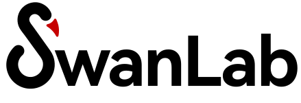
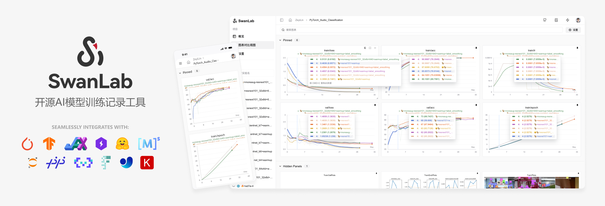
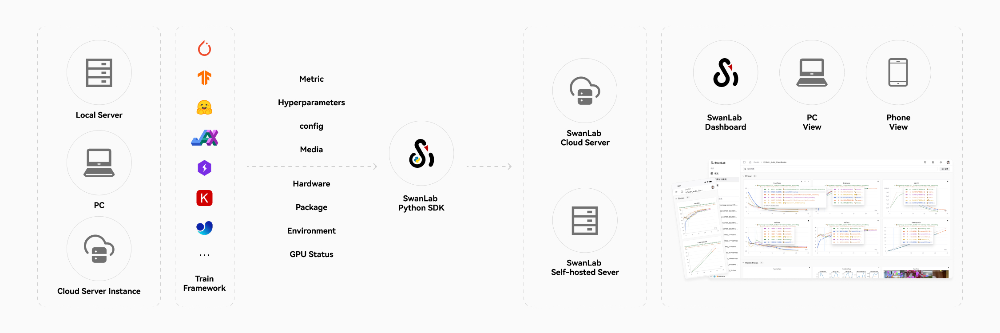
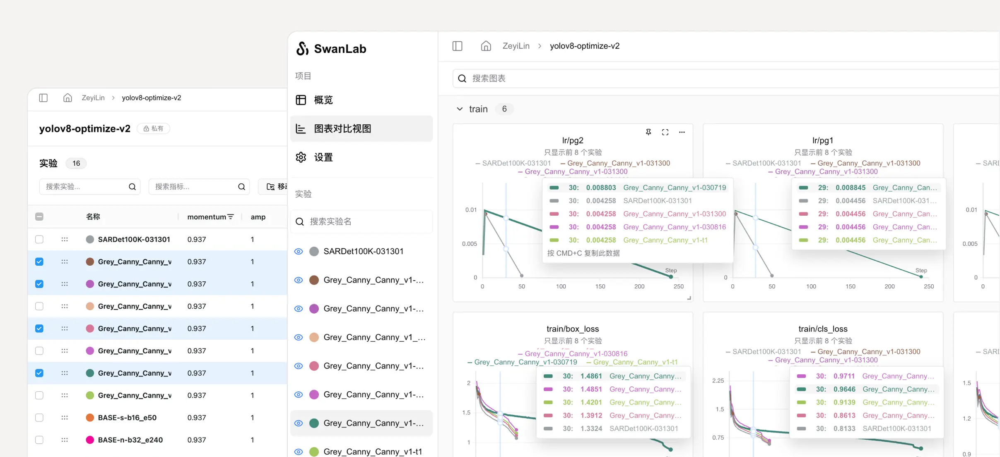
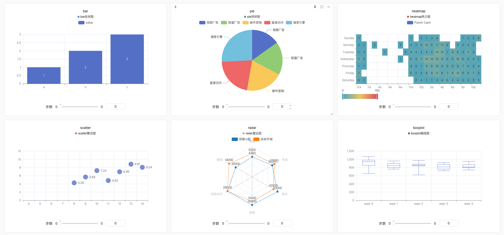
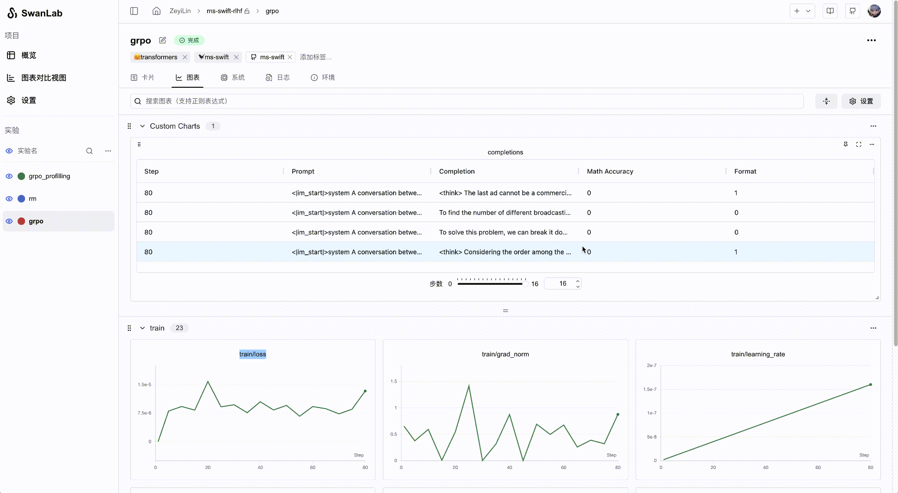
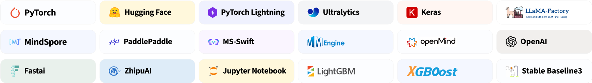
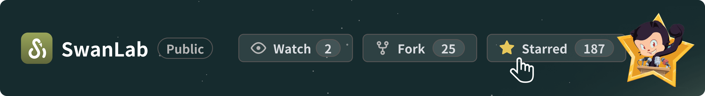
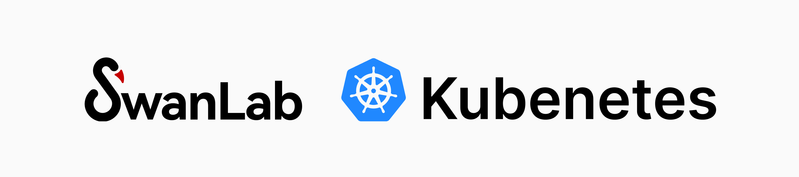
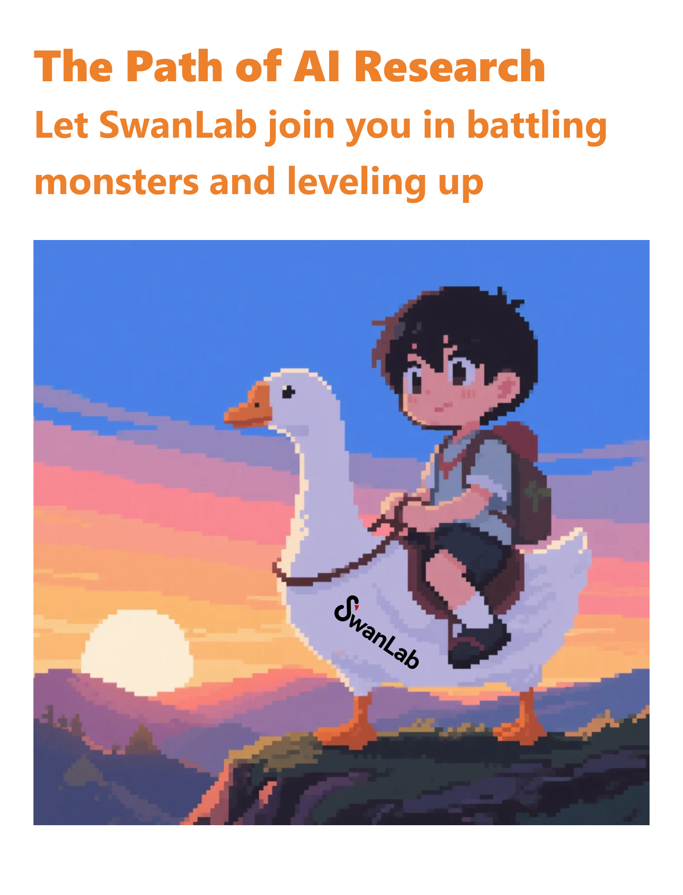

<div align="center">

<picture>
  <source media="(prefers-color-scheme: dark)" srcset="readme_files/swanlab-logo-type2-dark.svg">
  <source media="(prefers-color-scheme: light)" srcset="readme_files/swanlab-logo-type2-light.svg">
  
</picture>

An Professional, Modern-Designed AI Training Analysis Platform  
For Model Training Teams, Integrated with 50+ Leading AI Training Frameworks, Easily Combined with Your Experimental Code

<a href="https://swanlab.cn">🔥SwanLab Online</a> · <a href="https://docs.swanlab.cn">📃 Documentation</a> · <a href="https://github.com/swanhubx/swanlab/issues">Report Issues</a> · <a href="https://rcnpx636fedp.feishu.cn/share/base/form/shrcnwT9dTedqUchdpgzPzKvcmd">Feedback</a> · <a href="https://docs.swanlab.cn/en/guide_cloud/general/changelog.html">Changelog</a> · <a href="https://github.com/SwanHubX/SwanLab-Skill">SKILL</a>

[![][release-shield]][release-link]
[![][dockerhub-shield]][dockerhub-link]
[![][github-stars-shield]][github-stars-link]
[![][github-issues-shield]][github-issues-shield-link]
[![][github-contributors-shield]][github-contributors-link]
[![][license-shield]][license-shield-link]  
[![][tracking-swanlab-shield]][tracking-swanlab-shield-link]
[![][last-commit-shield]][last-commit-shield-link]
[![][pypi-version-shield]][pypi-version-shield-link]
[![][wechat-shield]][wechat-shield-link]
[![][pypi-downloads-shield]][pypi-downloads-shield-link]
[![][colab-shield]][colab-shield-link]



[中文](README.md) / English / [日本語](README_JP.md) / [Русский](README_RU.md)

👋 Join our [WeChat Group](https://docs.swanlab.cn/en/guide_cloud/community/online-support.html)

</div>

## Table of Contents

- [👋🏻 What is SwanLab](#-what-is-swanlab)
- [📃 Online Demo](#-online-demo)
- [🏁 Quick Start](#-quick-start)
- [💻 Self-Hosting](#-self-hosting)
- [🔥 Tutorials](#-tutorials)
- [🚗 Framework Integration](#-framework-integration)
- [🔌 Plugins](#-plugins)
- [🎮 Hardware Monitoring](#-hardware-monitoring)
- [🆚 Comparison with Familiar Tools](#-comparison-with-familiar-tools)
- [👥 Community](#-community)
- [📃 License](#-license)

<br/>

## 👋🏻 What is SwanLab

SwanLab is an open-source, lightweight AI model training tracking and visualization tool, providing a platform for tracking, recording, comparing, and collaborating on experiments.

SwanLab is designed for AI researchers, offering a friendly Python API and a beautiful UI interface, and providing features such as **training visualization, automatic logging, hyperparameter recording, experiment comparison, and multi-user collaboration**. With SwanLab, researchers can identify training issues through intuitive visual charts, compare multiple experiments to find research inspiration, and break down team communication barriers through **online web sharing** and **multi-user collaborative training** within organizations, improving organizational training efficiency.

https://github.com/user-attachments/assets/7965fec4-c8b0-4956-803d-dbf177b44f54

Here is a list of its core features:

**1. 📊 Experiment Metrics and Hyperparameter Tracking**: Minimal code integration into your machine learning pipeline to track and record key training metrics.

- ☁️ Supports **cloud** usage (similar to Weights & Biases), allowing you to check training progress anytime, anywhere. [How to view experiments on mobile](https://docs.swanlab.cn/en/guide_cloud/general/app.html).



- 🌸 **Visualizing the Training Process**: By visualizing experiment tracking data through the UI interface, trainers can intuitively observe the results at each step of the experiment, analyze metric trends, and determine which changes led to improved model performance—ultimately enhancing the overall efficiency of model iteration.



- Supports **hyperparameter recording** and table display.

- **Supported metadata types**: Scalar metrics, images, audio, text, 3D point clouds, biological chemical molecules, Echarts custom chart...

- **Resume Training Record**: Supports recording new metrics data to the same experiment after training is completed/interrupted.


- **Supported chart types**: Line charts, media charts (images, audio, text, 3D point clouds, biological chemical molecules), Bar charts, Scatter charts, Box plots, Heat maps, Pie charts, Radar charts, [Custom charts](https://docs.swanlab.cn/en/guide_cloud/experiment_track/log-custom-chart.html)...



- **Text Chart**: A text chart for large language model training, supporting Markdown rendering.



- **Automatic background logging**: Logging, hardware environment, Git repository, Python environment, Python library list, project runtime directory.

**2. ⚡️ Comprehensive Framework Integration**: PyTorch, 🤗HuggingFace Transformers, PyTorch Lightning, 🦙LLaMA Factory, MMDetection, Ultralytics, PaddleDetection, LightGBM, XGBoost, Keras, Tensorboard, Weights&Biases, Swift, XTuner, Stable Baseline3, Hydra, and more, totaling **30+** frameworks.



**3. 💻 Hardware Monitoring**: Supports real-time recording and monitoring of system-level hardware metrics for CPU, NPU (Ascend), GPU (Nvidia), AMD (ROCm), MLU (Cambricon), XLU (Kunlunxin), DCU (Hygon), MetaX GPU (Moxing), Moore Threads GPU (Moore Threads), Iluvatar GPU (Iluvatar), and memory.

**4. 📦 Experiment Management**: Through a centralized dashboard designed for training scenarios, quickly overview and manage multiple projects and experiments.

**5. 🆚 Result Comparison**: Compare hyperparameters and results of different experiments through online tables and comparison charts to uncover iteration insights.

**6. 👥 Online Collaboration**: Collaborate with your team on training, supporting real-time synchronization of experiments under a single project. You can view team training records online and provide feedback and suggestions based on results.

**7. ✉️ Share Results**: Copy and send persistent URLs to share each experiment, easily send to partners, or embed in online notes.

**8. 💻 Self-Hosting Support**: Supports offline usage, and the self-hosted community edition also allows viewing dashboards and managing experiments.

**9. 🔌 Plugin Extensions**: Supports extending SwanLab's usage scenarios through plugins, such as [Lark Notifications](https://docs.swanlab.cn/en/plugin/notification-lark.html), [Slack Notifications](https://docs.swanlab.cn/en/plugin/notification-slack.html), [CSV Logger](https://docs.swanlab.cn/en/plugin/writer-csv.html), etc.

> \[!IMPORTANT]
>
> **Star the project** to receive all release notifications from GitHub without delay ～ ⭐️



<br>

## 📃 Online Demo

Check out SwanLab's online demos:

|                   [ResNet50 Cat-Dog Classification][demo-cats-dogs]                   |                              [Yolov8-COCO128 Object Detection][demo-yolo]                              |
| :-----------------------------------------------------------------------------------: | :----------------------------------------------------------------------------------------------------: |
|                      [![][demo-cats-dogs-image]][demo-cats-dogs]                      |                                   [![][demo-yolo-image]][demo-yolo]                                    |
| Track a simple ResNet50 model training on a cat-dog dataset for image classification. | Use Yolov8 on the COCO128 dataset for object detection, tracking training hyperparameters and metrics. |

|                      [Qwen2 Instruction Fine-Tuning][demo-qwen2-sft]                       |                   [LSTM Google Stock Prediction][demo-google-stock]                   |
| :----------------------------------------------------------------------------------------: | :-----------------------------------------------------------------------------------: |
|                        [![][demo-qwen2-sft-image]][demo-qwen2-sft]                         |                   [![][demo-google-stock-image]][demo-google-stock]                   |
| Track Qwen2 large language model instruction fine-tuning for simple instruction following. | Use a simple LSTM model on Google stock price dataset to predict future stock prices. |

|              [ResNeXt101 Audio Classification][demo-audio-classification]              |            [Qwen2-VL COCO Dataset Fine-Tuning][demo-qwen2-vl]             |
| :------------------------------------------------------------------------------------: | :-----------------------------------------------------------------------: |
|           [![][demo-audio-classification-image]][demo-audio-classification]            |                 [![][demo-qwen2-vl-image]][demo-qwen2-vl]                 |
| Progressive experimental process from ResNet to ResNeXt on audio classification tasks. | Fine-tune Qwen2-VL multimodal large model on COCO2014 dataset using Lora. |

| [EasyR1 multimodal LLM RL Training][demo-easyr1-rl] |       [Qwen2.5-0.5B GRPO Training][demo-qwen2-grpo]       |
| :-------------------------------------------------: | :-------------------------------------------------------: |
|     [![][demo-easyr1-rl-image]][demo-easyr1-rl]     |       [![][demo-qwen2-grpo-image]][demo-qwen2-grpo]       |
| Use EasyR1 framework for multimodal LLM RL training | Fine-tune Qwen2.5-0.5B model on GSM8k dataset using GRPO. |

[More Examples](https://docs.swanlab.cn/en/examples/mnist.html)

<br>

## 🏁 Quick Start

### 1. Installation

```bash
pip install swanlab
```

<details><summary>Install from Source</summary>

If you want to experience the latest features, you can install from the source code.

```bash
# Method 1
git clone https://github.com/SwanHubX/SwanLab.git
pip install -e .

# Method 2
pip install git+https://github.com/SwanHubX/SwanLab.git
```

</details>

<details><summary>Dashboard Extension Installation</summary>

[Dashboard Extension Documentation](https://docs.swanlab.cn/en/guide_cloud/offline-board.html)

```bash
pip install 'swanlab[dashboard]'
```

</details>

### 2. Login and Get API Key

1. Register for free at [SwanLab](https://swanlab.cn).

2. Log in, and copy your API Key from User Settings > [API Key](https://swanlab.cn/settings).

3. Open the terminal and enter:

```bash
swanlab login
```

When prompted, enter your API Key, press Enter, and complete the login.

### 3. Integrate SwanLab with Your Code

```python
import swanlab

# Initialize a new SwanLab experiment
swanlab.init(
    project="my-first-ml",
    config={"learning-rate": 0.003},
)

# Log metrics
for i in range(10):
    swanlab.log({"loss": i, "acc": i})
```

Done! Head over to [SwanLab](https://swanlab.cn) to view your first SwanLab experiment.

<br>

## 💻 Self-Hosted

The self-hosted community edition supports offline viewing of the SwanLab dashboard.



Detailed deployment documentation:

- [🔗 Kubernetes Deployment Documentation](https://docs.swanlab.cn/en/self_host/kubernetes/deploy.html)
- [🔗 Docker Deployment Documentation](https://docs.swanlab.cn/en/self_host/docker/deploy.html)
- [🔗 Migration from Docker to Kubernetes Documentation](https://docs.swanlab.cn/en/self_host/docker/migration-docker-kubernetes.html)

<br>

## 🔥 Tutorials

**Excellent Open-Source Tutorial Projects Using SwanLab:**

- [happy-llm](https://github.com/datawhalechina/happy-llm): A tutorial on the principles and practice of large language models from scratch. 
- [self-llm](https://github.com/datawhalechina/self-llm): "A Cookbook for Open-Source Large Models" - A tutorial tailored for Chinese users on quickly fine-tuning (full-parameter/LoRA) and deploying domestic and international open-source Large Language Models (LLMs) / Multi-modal Large Models (MLLMs) in a Linux environment. 
- [Minimind](https://github.com/jingyaogong/minimind): 🌏 Train a 26M-parameter GPT from scratch in just 2h! 
- [unlock-deepseek](https://github.com/datawhalechina/unlock-deepseek): Interpretation, extension, and reproduction of the DeepSeek series of works. 
- [Qwen3-SmVL](https://github.com/ShaohonChen/Qwen3-SmVL): The visual head of SmolVLM2 was concatenated and fine-tuned with the Qwen3-0.6B model. 
- [OPPO/Agent_Foundation_Models](https://github.com/OPPO-PersonalAI/Agent_Foundation_Models): Chain-of-Agents: A chain-of-agents model through multi-agent distillation and agent RL. 
- [Tree-GRPO](https://github.com/AMAP-ML/Tree-GRPO): [ICLR 2026] Tree Search for LLM Agent Reinforcement Learning 
- [llm-agent-rl-lab](https://github.com/KMnO4-zx/llm-agent-rl-lab): Reproducing and studying RL algorithms for LLM agents, including PPO, GRPO, GSPO, DAPO, OPD and beyond. 

**Excellent Research Papers Using SwanLab:**

- [Accelerating AlphaZero Training for Connect6 via Behavioral Cloning Initialization and Prior Action Masking in Resource-Constrained Environments](https://papers.ssrn.com/sol3/papers.cfm?abstract_id=6730709)
- [SeePhys Pro: Diagnosing Modality Transfer and Blind-Training Effects in Multimodal RLVR for Physics Reasoning](https://arxiv.org/abs/2605.09266)
- [MemFactory: Unified Inference & Training Framework for Agent Memory](https://arxiv.org/abs/2603.29493)
- [ILL: A Lightweight Large Language Model for Legal and Courtroom Assistance](https://www.mdpi.com/2079-9292/15/11/2401)
- [Retrieval, Reward, and Training Protocols: What Matters in Training Search Agents?](https://arxiv.org/pdf/2605.27881)
- [MolAct: An Agentic RL Framework for Molecular Editing and Property Optimization](https://arxiv.org/abs/2512.20135)
- [CQLLM: A Framework for Generating CodeQL Security Vulnerability Detection Code Based on Large Language Model](https://www.preprints.org/manuscript/202510.1458)
- [Animation Needs Attention: A Holistic Approach to Slides Animation Comprehension with Visual-Language Models](https://arxiv.org/abs/2507.03916)
- [Efficient Model Fine-Tuning with LoRA for Biomedical Named Entity Recognition](https://ieeexplore.ieee.org/abstract/document/11082049/)
- [SpectrumWorld: Artificial Intelligence Foundation for Spectroscopy](https://arxiv.org/abs/2508.01188)
- [CodeBoost: Boosting Code LLMs by Squeezing Knowledge from Code Snippets with RL](https://arxiv.org/pdf/2508.05242)
- [A Joint Classification Method for Traditional Chinese Medicine Diseases and Syndromes Based on BertChinese-RCNNATTN](https://dl.acm.org/doi/full/10.1145/3759972.3759979)
- [A Gradient-Norm-Aware Optimizer for Symmetry-Preserving and Stable Deep Learning](https://www.mdpi.com/2073-8994/18/2/374)
- [TrafficBM: A Dual-Modality Pre-Training Framework for Network Traffic Classification](https://ieeexplore.ieee.org/document/11304658)
- [Using Human Cumulative Prospect Theory to Understand Large Language Models Decision-Making](https://ieeexplore.ieee.org/document/11300712)
- [BiPACE: Bisimulation-Guided Policy Optimization with Action Counterfactual Estimation for LLM Agents](https://arxiv.org/abs/2606.25556)

**Tutorial Articles:**

- [MNIST Handwritten Digit Recognition](https://docs.swanlab.cn/en/examples/mnist.html)
- [FashionMNIST Apparel Classification](https://docs.swanlab.cn/en/examples/fashionmnist.html)
- [CIFAR-10 Image Classification](https://docs.swanlab.cn/en/examples/cifar10.html)
- [ResNet Cat vs. Dog Classification](https://docs.swanlab.cn/en/examples/cats_dogs_classification.html)
- [YOLO Object Detection](https://docs.swanlab.cn/en/examples/yolo.html)
- [U-Net Medical Image Segmentation](https://docs.swanlab.cn/en/examples/unet-medical-segmentation.html)
- [Audio Classification](https://docs.swanlab.cn/en/examples/audio_classification.html)
- [DQN Reinforcement Learning - CartPole](https://docs.swanlab.cn/en/examples/dqn_cartpole.html)
- [LSTM Google Stock Price Prediction](https://docs.swanlab.cn/en/examples/audio_classification.html)
- [BERT Text Classification](https://docs.swanlab.cn/en/examples/bert.html)
- [Stable Diffusion Text-to-Image Fine-Tuning](https://docs.swanlab.cn/en/examples/stable_diffusion.html)
- [LLM Pre-training](https://docs.swanlab.cn/en/examples/pretrain_llm.html)
- [GLM4 Instruction Fine-Tuning](https://docs.swanlab.cn/en/examples/glm4-instruct.html)
- [Qwen Downstream Task Training](https://docs.swanlab.cn/en/examples/qwen_finetune.html)
- [NER (Named Entity Recognition)](https://docs.swanlab.cn/en/examples/ner.html)
- [Qwen3 Medical Model Fine-Tuning](https://docs.swanlab.cn/en/examples/qwen3-medical.html)
- [Qwen2-VL Multimodal Large Model Fine-Tuning in Practice](https://docs.swanlab.cn/en/examples/qwen_vl_coco.html)
- [GRPO Large Model Reinforcement Learning](https://docs.swanlab.cn/en/examples/qwen_grpo.html)
- [Training the Qwen3-SmVL-0.6B Multimodal Model](https://docs.swanlab.cn/en/examples/qwen3_smolvlm_muxi.html)
- [Getting Started with Embodied AI using LeRobot](https://docs.swanlab.cn/en/examples/robot/lerobot-guide.html)
- [GLM-4.5-Air-LoRA and SwanLab Visualization](https://github.com/datawhalechina/self-llm/blob/master/models/GLM-4.5-Air/03-GLM-4.5-Air-Lora%20%E5%8F%8A%20Swanlab%20%E5%8F%AF%E8%A7%86%E5%8C%96%E5%BE%AE%E8%B0%83.md)
- [How to do RAG? SwanLab Document Assistant Solution Released](https://docs.swanlab.cn/course/prompt_engineering_course/11-swanlab_rag/1.swanlab-rag.html)

<br>

## 🚗 Framework Integration

Use your favorite frameworks with SwanLab!  
Below is a list of frameworks we have integrated. Feel free to submit an [Issue](https://github.com/swanhubx/swanlab/issues) to request integration for your desired framework.

**Basic Frameworks**

- [PyTorch](https://docs.swanlab.cn/en/guide_cloud/integration/integration-pytorch.html)
- [MindSpore](https://docs.swanlab.cn/en/guide_cloud/integration/integration-ascend.html)
- [Keras](https://docs.swanlab.cn/en/guide_cloud/integration/integration-keras.html)

**LLM Training Frameworks**

- [HuggingFace Transformers](https://docs.swanlab.cn/en/guide_cloud/integration/integration-huggingface-transformers.html)
- [LLaMA Factory](https://docs.swanlab.cn/en/guide_cloud/integration/integration-llama-factory.html)
- [MS-Swift](https://docs.swanlab.cn/en/guide_cloud/integration/integration-swift.html)
- [Unsloth](https://docs.swanlab.cn/en/guide_cloud/integration/integration-unsloth.html)
- [MLX-LM](https://docs.swanlab.cn/en/guide_cloud/integration/integration-mlx-lm.html)
- [Torchtune](https://docs.swanlab.cn/en/guide_cloud/integration/integration-pytorch-torchtune.html)
- [PaddleNLP](https://docs.swanlab.cn/en/guide_cloud/integration/integration-paddlenlp.html)
- [Sentence Transformers](https://docs.swanlab.cn/en/guide_cloud/integration/integration-sentence-transformers.html)
- [XTuner](https://docs.swanlab.cn/en/guide_cloud/integration/integration-xtuner.html)
- [OpenMind](https://modelers.cn/docs/en/openmind-library/1.0.0/basic_tutorial/finetune/finetune_pt.html#install-swanlab)

**LLM Reinforcement Learning Frameworks**

- [veRL](https://docs.swanlab.cn/en/guide_cloud/integration/integration-verl.html)
- [HuggingFace trl](https://docs.swanlab.cn/en/guide_cloud/integration/integration-huggingface-trl.html)
- [NVIDIA-NeMo RL](https://docs.swanlab.cn/en/guide_cloud/integration/integration-nvidia-nemo-rl.html)
- [EasyR1](https://docs.swanlab.cn/en/guide_cloud/integration/integration-easyr1.html)
- [AReaL](https://docs.swanlab.cn/en/guide_cloud/integration/integration-areal.html)
- [ROLL](https://docs.swanlab.cn/en/guide_cloud/integration/integration-roll.html)

**Robot Frameworks**

- [RLinf](https://docs.swanlab.cn/en/guide_cloud/integration/integration-rlinf.html)

**Text-to-Image/Video Training Frameworks**

- [DiffSynth Studio](https://docs.swanlab.cn/en/guide_cloud/integration/integration-diffsynth-studio.html)

**Deep Learning Frameworks**

- [PyTorch Lightning](https://docs.swanlab.cn/en/guide_cloud/integration/integration-pytorch-lightning.html)
- [MMEngine](https://docs.swanlab.cn/en/guide_cloud/integration/integration-mmengine.html)
- [FastAI](https://docs.swanlab.cn/en/guide_cloud/integration/integration-fastai.html)

**Computer Vision Frameworks**

- [Ultralytics](https://docs.swanlab.cn/en/guide_cloud/integration/integration-ultralytics.html)
- [MMDetection](https://docs.swanlab.cn/en/guide_cloud/integration/integration-mmdetection.html)
- [MMSegmentation](https://docs.swanlab.cn/en/guide_cloud/integration/integration-mmsegmentation.html)
- [PaddleDetection](https://docs.swanlab.cn/en/guide_cloud/integration/integration-paddledetection.html)
- [PaddleYOLO](https://docs.swanlab.cn/en/guide_cloud/integration/integration-paddleyolo.html)

**Machine Learning Frameworks**

- [LightGBM](https://docs.swanlab.cn/en/guide_cloud/integration/integration-lightgbm.html)
- [XGBoost](https://docs.swanlab.cn/en/guide_cloud/integration/integration-xgboost.html)
- [CatBoost](https://docs.swanlab.cn/en/guide_cloud/integration/integration-catboost.html)

**Evaluation Frameworks**

- [EvalScope](https://docs.swanlab.cn/en/guide_cloud/integration/integration-evalscope.html)

**Traditional Reinforcement Learning Frameworks**

- [Stable Baseline3](https://docs.swanlab.cn/en/guide_cloud/integration/integration-sb3.html)

**Other Frameworks:**

- [Tensorboard](https://docs.swanlab.cn/en/guide_cloud/integration/integration-tensorboard.html)
- [Weights&Biases](https://docs.swanlab.cn/en/guide_cloud/integration/integration-wandb.html)
- [MLFlow](https://docs.swanlab.cn/en/guide_cloud/integration/integration-mlflow.html)
- [HuggingFace Accelerate](https://docs.swanlab.cn/en/guide_cloud/integration/integration-huggingface-accelerate.html)
- [Ray](https://docs.swanlab.cn/en/guide_cloud/integration/integration-ray.html)
- [Hydra](https://docs.swanlab.cn/en/guide_cloud/integration/integration-hydra.html)
- [Omegaconf](https://docs.swanlab.cn/en/guide_cloud/integration/integration-omegaconf.html)
- [SpecForge](https://docs.swanlab.cn/en/guide_cloud/integration/integration-specforge.html)

[More Integrations](https://docs.swanlab.cn/en/guide_cloud/integration/integration-any-library.html)

<br>

## 🔌 Plugins

Enhance your experiment management experience by extending SwanLab's functionality through plugins!

- [Customize Your Plugin](https://docs.swanlab.cn/en/plugin/custom-plugin.html)
- [Email Notification](https://docs.swanlab.cn/en/plugin/notification-email.html)
- [Lark Notification](https://docs.swanlab.cn/en/plugin/notification-lark.html)
- [DingTalk Notification](https://docs.swanlab.cn/en/plugin/notification-dingtalk.html)
- [WXWork Notification](https://docs.swanlab.cn/en/plugin/notification-wxwork.html)
- [Discord Notification](https://docs.swanlab.cn/en/plugin/notification-discord.html)
- [Slack Notification](https://docs.swanlab.cn/en/plugin/notification-slack.html)
- [Bark Notification](https://docs.swanlab.cn/en/plugin/notification-bark.html)
- [CSV Logger](https://docs.swanlab.cn/en/plugin/writer-csv.html)

<br>

## 🎮 Hardware Monitoring

SwanLab records the **hardware information** and **resource usage** during AI training. Below is a table of supported hardware:

| Hardware        | Info Logging | Resource Monitoring | Script                                                                                                                                         |
| --------------- | ------------ | ------------------- | ---------------------------------------------------------------------------------------------------------------------------------------------- |
| NVIDIA GPU      | ✅           | ✅                  | [nvidia.py](https://github.com/SwanHubX/SwanLab/blob/main/swanlab/sdk/internal/probe_python/hardware_vendor/accelerator/nvidia.py)             |
| AMD GPU         | ✅           | ✅                  | [amd.py](https://github.com/SwanHubX/SwanLab/blob/main/swanlab/sdk/internal/probe_python/hardware_vendor/accelerator/amd.py)                   |
| Ascend NPU      | ✅           | ✅                  | [ascend.py](https://github.com/SwanHubX/SwanLab/blob/main/swanlab/sdk/internal/probe_python/hardware_vendor/accelerator/huawei.py)             |
| Cambricon MLU   | ✅           | ✅                  | [cambricon.py](https://github.com/SwanHubX/SwanLab/blob/main/swanlab/sdk/internal/probe_python/hardware_vendor/accelerator/cambricon.py)       |
| Kunlunxin XPU   | ✅           | ✅                  | [kunlunxin.py](https://github.com/SwanHubX/SwanLab/blob/main/swanlab/sdk/internal/probe_python/hardware_vendor/accelerator/kunlunxin.py)       |
| MooreThread GPU | ✅           | ✅                  | [moorethreads.py](https://github.com/SwanHubX/SwanLab/blob/main/swanlab/sdk/internal/probe_python/hardware_vendor/accelerator/moorethreads.py) |
| MetaX GPU       | ✅           | ✅                  | [metax.py](https://github.com/SwanHubX/SwanLab/blob/main/swanlab/sdk/internal/probe_python/hardware_vendor/accelerator/metax.py)               |
| Iluvatar GPU    | ✅           | ✅                  | [iluvatar.py](https://github.com/SwanHubX/SwanLab/blob/main/swanlab/sdk/internal/probe_python/hardware_vendor/accelerator/iluvatar.py)         |
| Hygon DCU       | ✅           | ✅                  | [hygon.py](https://github.com/SwanHubX/SwanLab/blob/main/swanlab/sdk/internal/probe_python/hardware_vendor/accelerator/hygon.py)               |
| CPU             | ✅           | ✅                  | [cpu.py](https://github.com/SwanHubX/SwanLab/blob/main/swanlab/sdk/internal/probe_python/hardware_vendor/cpu.py)                               |
| Memory          | ✅           | ✅                  | [memory.py](https://github.com/SwanHubX/SwanLab/blob/main/swanlab/sdk/internal/probe_python/hardware_vendor/memory.py)                         |

If you wish to document other hardware, feel free to submit an Issue or PR!

<br>

## 🆚 Comparison with Familiar Tools

### Tensorboard vs SwanLab

- **☁️ Online Support**:
  SwanLab allows convenient cloud-based synchronization and storage of training experiments, enabling remote viewing of training progress, managing historical projects, sharing experiment links, sending real-time notifications, and multi-device experiment viewing. Tensorboard, on the other hand, is an offline experiment tracking tool.

- **👥 Multi-User Collaboration**:
  SwanLab facilitates multi-user, cross-team machine learning collaboration by easily managing team training projects, sharing experiment links, and enabling cross-space discussions. Tensorboard is primarily designed for individual use, making multi-user collaboration and experiment sharing difficult.

- **💻 Persistent, Centralized Dashboard**:
  Regardless of where you train your models—on a local computer, a lab cluster, or a public cloud GPU instance—your results are recorded in the same centralized dashboard. TensorBoard requires time-consuming copying and management of TFEvent files from different machines.

- **💪 More Powerful Tables**:
  SwanLab tables allow you to view, search, and filter results from different experiments, making it easy to review thousands of model versions and identify the best-performing models for different tasks. TensorBoard is not suitable for large-scale projects.

### Weights and Biases vs SwanLab

- Weights and Biases is a closed-source MLOps platform that requires an internet connection.

- SwanLab not only supports online usage but also offers an open-source, free, self-hosted version.

<br>

## 👥 Community

### Repositories

- [self-hosted](https://github.com/swanhubx/self-hosted): The repository for private deployment scripts.
- [SwanLab-Docs](https://github.com/swanhubx/swanlab-docs): The official documentation repository.
- [SwanLab-Dashboard](https://github.com/swanhubx/swanlab-dashboard): The offline dashboard repository, which contains the web code for the lightweight offline dashboard opened by `swanlab watch`.

### Community and Support

- [GitHub Issues](https://github.com/SwanHubX/SwanLab/issues): Errors and issues encountered while using SwanLab.
- [Email Support](zeyi.lin@swanhub.co): Feedback and questions about using SwanLab.
- <a href="https://docs.swanlab.cn/en/guide_cloud/community/online-support.html">WeChat Group</a>: Discuss SwanLab usage and share the latest AI technologies.

### SwanLab README Badge

If you enjoy using SwanLab in your work, please add the SwanLab badge to your README:

[![][tracking-swanlab-shield]][tracking-swanlab-shield-link]、[![][visualize-swanlab-shield]][visualize-swanlab-shield-link]

```
[](your experiment url)
[](your experiment url)
```

More design materials: [assets](https://github.com/SwanHubX/assets)

### Citing SwanLab in Papers

If you find SwanLab helpful in your research journey, please consider citing it in the following format:

```bibtex
@software{Zeyilin_SwanLab_2023,
  author = {Zeyi Lin, Shaohong Chen, Kang Li, Qiushan Jiang, Zirui Cai,  Kaifang Ji and {The SwanLab team}},
  doi = {10.5281/zenodo.11100550},
  license = {Apache-2.0},
  title = {{SwanLab}},
  url = {https://github.com/swanhubx/swanlab},
  year = {2023}
}
```

### Contributing to SwanLab

Considering contributing to SwanLab? First, take a moment to read the [Contribution Guide](CONTRIBUTING.md).

We also greatly appreciate support through social media, events, and conference sharing. Thank you!

<br>

**Contributors**

<a href="https://github.com/swanhubx/swanlab/graphs/contributors">
  
</a>

<br>



## 📃 License

This repository is licensed under the [Apache 2.0 License](https://github.com/SwanHubX/SwanLab/blob/main/LICENSE).

## Star History

<a href="https://www.star-history.com/?repos=swanhubx%2Fswanlab&type=date&legend=top-left">
 <picture>
   <source media="(prefers-color-scheme: dark)" srcset="https://api.star-history.com/chart?repos=swanhubx/swanlab&type=date&theme=dark&legend=top-left&sealed_token=77bt2XJC-p2PM1tRv6wxVLEw_RaNVx2MVWL-FFg2yjKRstx-vq6M_Y0yszVSAAYT4CvkjYMlgSOPU-mvyq_FfRWs7hh2-VFJiwQMtvyr1-7i0F6VgeQwQw" />
   <source media="(prefers-color-scheme: light)" srcset="https://api.star-history.com/chart?repos=swanhubx/swanlab&type=date&legend=top-left&sealed_token=77bt2XJC-p2PM1tRv6wxVLEw_RaNVx2MVWL-FFg2yjKRstx-vq6M_Y0yszVSAAYT4CvkjYMlgSOPU-mvyq_FfRWs7hh2-VFJiwQMtvyr1-7i0F6VgeQwQw" />
   
 </picture>
</a>

<!-- link -->

[release-shield]: https://img.shields.io/github/v/release/swanhubx/swanlab?color=369eff&labelColor=black&logo=github&style=flat-square
[release-link]: https://github.com/swanhubx/swanlab/releases
[license-shield]: https://img.shields.io/badge/license-apache%202.0-white?labelColor=black&style=flat-square
[license-shield-link]: https://github.com/SwanHubX/SwanLab/blob/main/LICENSE
[last-commit-shield]: https://img.shields.io/github/last-commit/swanhubx/swanlab?color=c4f042&labelColor=black&style=flat-square
[last-commit-shield-link]: https://github.com/swanhubx/swanlab/commits/main
[pypi-version-shield]: https://img.shields.io/pypi/v/swanlab?color=orange&labelColor=black&style=flat-square
[pypi-version-shield-link]: https://pypi.org/project/swanlab/
[pypi-downloads-shield]: https://static.pepy.tech/badge/swanlab?labelColor=black&style=flat-square
[pypi-downloads-shield-link]: https://pepy.tech/project/swanlab
[swanlab-cloud-shield]: https://img.shields.io/badge/Product-SwanLab云端版-636a3f?labelColor=black&style=flat-square
[swanlab-cloud-shield-link]: https://swanlab.cn/
[wechat-shield]: https://img.shields.io/badge/WeChat-微信-4cb55e?labelColor=black&style=flat-square
[wechat-shield-link]: https://docs.swanlab.cn/en/guide_cloud/community/online-support.html
[colab-shield]: https://colab.research.google.com/assets/colab-badge.svg
[colab-shield-link]: https://colab.research.google.com/drive/1RWsrY_1bS8ECzaHvYtLb_1eBkkdzekR3?usp=sharing
[github-stars-shield]: https://img.shields.io/github/stars/swanhubx/swanlab?labelColor&style=flat-square&color=ffcb47
[github-stars-link]: https://github.com/swanhubx/swanlab
[github-issues-shield]: https://img.shields.io/github/issues/swanhubx/swanlab?labelColor=black&style=flat-square&color=ff80eb
[github-issues-shield-link]: https://github.com/swanhubx/swanlab/issues
[github-contributors-shield]: https://img.shields.io/github/contributors/swanhubx/swanlab?color=c4f042&labelColor=black&style=flat-square
[github-contributors-link]: https://github.com/swanhubx/swanlab/graphs/contributors
[demo-cats-dogs]: https://swanlab.cn/@ZeyiLin/Cats_Dogs_Classification/runs/jzo93k112f15pmx14vtxf/chart
[demo-cats-dogs-image]: readme_files/example-catsdogs.png
[demo-yolo]: https://swanlab.cn/@ZeyiLin/ultratest/runs/yux7vclmsmmsar9ear7u5/chart
[demo-yolo-image]: readme_files/example-yolo.png
[demo-qwen2-sft]: https://swanlab.cn/@ZeyiLin/Qwen2-fintune/runs/cfg5f8dzkp6vouxzaxlx6/chart
[demo-qwen2-sft-image]: readme_files/example-qwen2.png
[demo-google-stock]: https://swanlab.cn/@ZeyiLin/Google-Stock-Prediction/charts
[demo-google-stock-image]: readme_files/example-lstm.png
[demo-audio-classification]: https://swanlab.cn/@ZeyiLin/PyTorch_Audio_Classification/charts
[demo-audio-classification-image]: readme_files/example-audio-classification.png
[demo-qwen2-vl]: https://swanlab.cn/@ZeyiLin/Qwen2-VL-finetune/runs/pkgest5xhdn3ukpdy6kv5/chart
[demo-qwen2-vl-image]: readme_files/example-qwen2-vl.jpg
[demo-easyr1-rl]: https://swanlab.cn/@Kedreamix/easy_r1/runs/wzezd8q36bb6dlza6wtpc/chart
[demo-easyr1-rl-image]: readme_files/example-easyr1-rl.png
[demo-qwen2-grpo]: https://swanlab.cn/@kmno4/Qwen-R1/runs/t0zr3ak5r7188mjbjgdsc/chart
[demo-qwen2-grpo-image]: readme_files/example-qwen2-grpo.png
[tracking-swanlab-shield-link]: https://swanlab.cn
[tracking-swanlab-shield]: https://raw.githubusercontent.com/SwanHubX/assets/main/badge2.svg
[visualize-swanlab-shield-link]: https://swanlab.cn
[visualize-swanlab-shield]: https://raw.githubusercontent.com/SwanHubX/assets/main/badge1.svg
[dockerhub-shield]: https://img.shields.io/docker/v/swanlab/swanlab-next?color=369eff&label=docker&labelColor=black&logoColor=white&style=flat-square
[dockerhub-link]: https://hub.docker.com/r/swanlab/swanlab-next/tags
