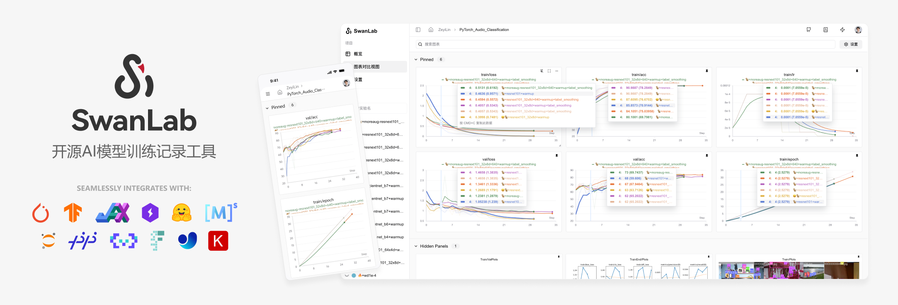
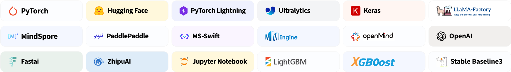
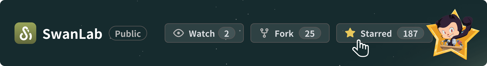
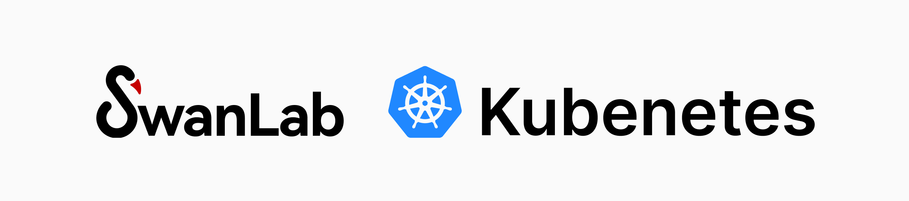

<div align="center">

<picture>
  <source media="(prefers-color-scheme: dark)" srcset="readme_files/swanlab-logo-type2-dark.svg">
  <source media="(prefers-color-scheme: light)" srcset="readme_files/swanlab-logo-type2-light.svg">
  
</picture>

プロフェッショナルな AI トレーニング分析プラットフォーム  
実験のイテレーションを高速化、50 種以上のトップクラスの AI トレーニングフレームワークと統合

<a href="https://swanlab.cn">🔥SwanLab オンライン版</a> · <a href="https://docs.swanlab.cn">📃 ドキュメント</a> · <a href="https://github.com/swanhubx/swanlab/issues">問題を報告</a> · <a href="https://rcnpx636fedp.feishu.cn/share/base/form/shrcnwT9dTedqUchdpgzPzKvcmd">フィードバックを提案</a> · <a href="https://docs.swanlab.cn/en/guide_cloud/general/changelog.html">更新履歴</a> · <a href="https://github.com/SwanHubX/SwanLab-Skill">SKILL</a>

[![][release-shield]][release-link]
[![][dockerhub-shield]][dockerhub-link]
[![][github-stars-shield]][github-stars-link]
[![][github-issues-shield]][github-issues-shield-link]
[![][github-contributors-shield]][github-contributors-link]
[![][license-shield]][license-shield-link]  
[![][tracking-swanlab-shield]][tracking-swanlab-shield-link]
[![][last-commit-shield]][last-commit-shield-link]
[![][pypi-version-shield]][pypi-version-shield-link]
[![][wechat-shield]][wechat-shield-link]
[![][pypi-downloads-shield]][pypi-downloads-shield-link]
[![][colab-shield]][colab-shield-link]



[中文](README.md) / [English](README_EN.md) / 日本語 / [Русский](README_RU.md)

👋 [WeChat グループ](https://docs.swanlab.cn/en/guide_cloud/community/online-support.html)に参加する

</div>

## 目次

- [👋🏻 SwanLab とは](#-swanlabとは)
- [📃 オンラインデモ](#-オンラインデモ)
- [🏁 クイックスタート](#-クイックスタート)
- [💻 セルフホスティング](#-セルフホスティング)
- [🔥 実践事例](#-実践事例)
- [🎮 ハードウェア監視](#-ハードウェア監視)
- [🚗 フレームワーク統合](#-フレームワーク統合)
- [🔌 プラグイン](#-プラグイン)
- [🆚 既存ツールとの比較](#-既存ツールとの比較)
- [👥 コミュニティ](#-コミュニティ)
- [📃 ライセンス](#-ライセンス)

<br/>

## 👋🏻 SwanLab とは

SwanLab は、オープンソースで軽量な AI モデルトレーニング追跡・可視化ツールで、実験の追跡、記録、比較、コラボレーションのためのプラットフォームを提供します。

https://github.com/user-attachments/assets/7965fec4-c8b0-4956-803d-dbf177b44f54

SwanLab は AI 研究者向けに設計され、使いやすい Python API と美しい UI を提供し、**トレーニングの可視化、自動ログ記録、ハイパーパラメータ記録、実験比較、複数人でのコラボレーション**などの機能を提供します。SwanLab では、研究者が直感的な可視化チャートを通じてトレーニングの問題を発見し、複数の実験を比較して研究のインスピレーションを得ることができます。また、**オンラインページ**での共有や組織ベースの**複数人でのトレーニング**を通じて、チーム間のコミュニケーションの壁を打破し、組織のトレーニング効率を向上させます。

以下はその主な機能リストです：

**1. 📊 実験指標とハイパーパラメータの追跡**: 機械学習パイプラインに簡単に組み込めるコードで、トレーニングのキー指標を追跡

- **クラウド**使用をサポート（Weights & Biases のような）、どこからでもトレーニングの進捗を確認可能。[携帯で実験を見る方法](https://docs.swanlab.cn/en/guide_cloud/general/app.html)
- **ハイパーパラメータ記録**とテーブル表示をサポート
- **サポートするメタデータタイプ**: スカラー指標、画像、音声、テキスト、3D 点群、生物化学分子...
- **サポートするチャートタイプ**: 折れ線グラフ、メディアグラフ（画像、音声、テキスト、3D 点群、生物化学分子）、...
- **バックグラウンドでの自動記録**: ログ記録、ハードウェア環境、Git リポジトリ、Python 環境、Python ライブラリリスト、プロジェクト実行ディレクトリ

**2. ⚡️ 幅広いフレームワーク統合**: PyTorch、🤗HuggingFace Transformers、PyTorch Lightning、🦙LLaMA Factory、MMDetection、Ultralytics、PaddleDetetion、LightGBM、XGBoost、Keras、Tensorboard、Weights&Biases、Swift、XTuner、Stable Baseline3、Hydra など**30 以上**のフレームワーク



**3. 💻 ハードウェア監視**: CPU、NPU（昇騰 Ascend）、GPU（Nvidia）、MLU（寒武紀 MLU）、メモリのシステムレベルのハードウェア指標をリアルタイムで記録・監視

**4. 📦 実験管理**: トレーニングシーン向けに設計された集中型ダッシュボードで、全体ビューを一目で確認し、複数のプロジェクトと実験を迅速に管理

**5. 🆚 結果の比較**: オンラインテーブルと比較チャートを使用して、異なる実験のハイパーパラメータと結果を比較し、イテレーションのインスピレーションを発掘

**6. 👥 オンラインコラボレーション**: チームと協力してトレーニングを行い、実験をリアルタイムで同期させ、チームのトレーニング記録をオンラインで確認し、結果に基づいて意見や提案を共有可能

**7. ✉️ 結果の共有**: 各実験の永続的な URL をコピーして送信し、パートナーに簡単に送信したり、オンラインノートに埋め込んだり可能

**8. 💻 セルフホスティング対応**: オフライン環境での使用をサポートし、セルフホスティングのコミュニティ版でもダッシュボードの表示と実験の管理が可能

**9. 🔌 プラグイン拡張**: プラグインを使用して SwanLab の使用シナリオを拡張できます。[Lark 通知](https://docs.swanlab.cn/en/plugin/notification-lark.html)、[Slack 通知](https://docs.swanlab.cn/en/plugin/notification-slack.html)、[CSV 記録器](https://docs.swanlab.cn/en/plugin/writer-csv.html)など。

> \[!IMPORTANT]
>
> **プロジェクトをスター**すると、GitHub からすべてのリリース通知を遅延なく受け取れます～ ⭐️



<br>

## 📃 オンラインデモ

SwanLab のオンラインデモをご覧ください：

|               [ResNet50 猫犬分類][demo-cats-dogs]                |              [Yolov8-COCO128 物体検出][demo-yolo]              |
| :--------------------------------------------------------------: | :------------------------------------------------------------: |
|           [![][demo-cats-dogs-image]][demo-cats-dogs]            |               [![][demo-yolo-image]][demo-yolo]                |
| 猫犬データセットでの簡単な ResNet50 モデルのトレーニングを追跡。 | Yolov8 を使用して COCO128 データセットで物体検出タスクを追跡。 |

|     [Qwen2 指示ファインチューニング][demo-qwen2-sft]     |                        [LSTM Google 株価予測][demo-google-stock]                         |
| :------------------------------------------------------: | :--------------------------------------------------------------------------------------: |
|       [![][demo-qwen2-sft-image]][demo-qwen2-sft]        |                    [![][demo-google-stock-image]][demo-google-stock]                     |
| Qwen2 大規模言語モデルの指示ファインチューニングを追跡。 | 簡単な LSTM モデルを使用して Google 株価データセットでトレーニングし、将来の株価を予測。 |

|         [ResNeXt101 音声分類][demo-audio-classification]          |                [Qwen2-VL COCO データセットファインチューニング][demo-qwen2-vl]                |
| :---------------------------------------------------------------: | :-------------------------------------------------------------------------------------------: |
| [![][demo-audio-classification-image]][demo-audio-classification] |                           [![][demo-qwen2-vl-image]][demo-qwen2-vl]                           |
|    ResNet から ResNeXt への音声分類タスクの進化的実験プロセス     | Qwen2-VL 多モーダル大規模モデルを使用して COCO2014 データセットで Lora ファインチューニング。 |

|      [EasyR1 multimodal LLM RL Training][demo-easyr1-rl]      |         [Qwen2.5-0.5B GRPO Training][demo-qwen2-grpo]          |
| :-----------------------------------------------------------: | :------------------------------------------------------------: |
|          [![][demo-easyr1-rl-image]][demo-easyr1-rl]          |         [![][demo-qwen2-grpo-image]][demo-qwen2-grpo]          |
| EasyR1 フレームワークを使用した多モーダル LLM RL トレーニング | Qwen2.5-0.5B モデルを GSM8k データセットで GRPO トレーニング。 |

[その他の例](https://docs.swanlab.cn/en/examples/mnist.html)

<br>

## 🏁 クイックスタート

### 1.インストール

```bash
pip install swanlab
```

<details><summary>ソースコードからのインストール</summary>

最新の機能を体験したい場合は、ソースコードからインストールすることができます。

```bash
# Method 1
git clone https://github.com/SwanHubX/SwanLab.git
pip install -e .

# Method 2
pip install git+https://github.com/SwanHubX/SwanLab.git
```

</details>

<details><summary>ダッシュボード拡張機能のインストール</summary>

[ダッシュボード拡張機能ドキュメント](https://docs.swanlab.cn/en/guide_cloud/offline-board.html)

```bash
pip install 'swanlab[dashboard]'
```

</details>

### 2.ログインして API キーを取得

1. 無料で[アカウント登録](https://swanlab.cn)

2. アカウントにログインし、ユーザー設定 > [API キー](https://swanlab.cn/settings)で API キーをコピー

3. ターミナルを開き、以下を入力：

```bash
swanlab login
```

プロンプトが表示されたら、API キーを入力して Enter を押し、ログインを完了。

### 3.SwanLab をコードに統合

```python
import swanlab

# 新しいSwanLab実験を初期化
swanlab.init(
    project="my-first-ml",
    config={"learning-rate": 0.003},
)

# 指標を記録
for i in range(10):
    swanlab.log({"loss": i, "acc": i})
```

完了！[SwanLab](https://swanlab.cn)で最初の SwanLab 実験を確認できます。

<br>

## 💻 セルフホスティング

セルフホスティングコミュニティ版は、SwanLab ダッシュボードをオフラインで閲覧することをサポートしています。



詳細なデプロイメントドキュメント：

- [🔗 Kubernetesデプロイメントドキュメント](https://docs.swanlab.cn/en/self_host/kubernetes/deploy.html)
- [🔗 Dockerデプロイメントドキュメント](https://docs.swanlab.cn/en/self_host/docker/deploy.html)
- [🔗 DockerからKubernetesへの移行ドキュメント](https://docs.swanlab.cn/en/self_host/docker/migration-docker-kubernetes.html)

<br>

## 🔥 実践事例

**SwanLab を使用した優れたオープンソースチュートリアルプロジェクト：**

- [llm-agent-rl-lab](https://github.com/KMnO4-zx/llm-agent-rl-lab): PPO、GRPO、GSPO、DAPO、OPD などを含む、LLM エージェント向け RL アルゴリズムの再現と研究。 

**SwanLab を使用した論文：**

- [Accelerating AlphaZero Training for Connect6 via Behavioral Cloning Initialization and Prior Action Masking in Resource-Constrained Environments](https://papers.ssrn.com/sol3/papers.cfm?abstract_id=6730709)
- [SeePhys Pro: Diagnosing Modality Transfer and Blind-Training Effects in Multimodal RLVR for Physics Reasoning](https://arxiv.org/abs/2605.09266)
- [MemFactory: Unified Inference & Training Framework for Agent Memory](https://arxiv.org/abs/2603.29493)
- [ILL: A Lightweight Large Language Model for Legal and Courtroom Assistance](https://www.mdpi.com/2079-9292/15/11/2401)
- [Retrieval, Reward, and Training Protocols: What Matters in Training Search Agents?](https://arxiv.org/pdf/2605.27881)
- [MolAct: An Agentic RL Framework for Molecular Editing and Property Optimization](https://arxiv.org/abs/2512.20135)
- [CQLLM: A Framework for Generating CodeQL Security Vulnerability Detection Code Based on Large Language Model](https://www.preprints.org/manuscript/202510.1458)
- [Animation Needs Attention: A Holistic Approach to Slides Animation Comprehension with Visual-Language Models](https://arxiv.org/abs/2507.03916)
- [Efficient Model Fine-Tuning with LoRA for Biomedical Named Entity Recognition](https://ieeexplore.ieee.org/abstract/document/11082049/)
- [SpectrumWorld: Artificial Intelligence Foundation for Spectroscopy](https://arxiv.org/abs/2508.01188)
- [CodeBoost: Boosting Code LLMs by Squeezing Knowledge from Code Snippets with RL](https://arxiv.org/pdf/2508.05242)
- [A Joint Classification Method for Traditional Chinese Medicine Diseases and Syndromes Based on BertChinese-RCNNATTN](https://dl.acm.org/doi/full/10.1145/3759972.3759979)
- [A Gradient-Norm-Aware Optimizer for Symmetry-Preserving and Stable Deep Learning](https://www.mdpi.com/2073-8994/18/2/374)
- [TrafficBM: A Dual-Modality Pre-Training Framework for Network Traffic Classification](https://ieeexplore.ieee.org/document/11304658)
- [Using Human Cumulative Prospect Theory to Understand Large Language Models Decision-Making](https://ieeexplore.ieee.org/document/11300712)
- [BiPACE: Bisimulation-Guided Policy Optimization with Action Counterfactual Estimation for LLM Agents](https://arxiv.org/abs/2606.25556)

<br>

## 🎮 ハードウェア監視

SwanLabはAIトレーニング中に使用される**ハードウェア情報**と**リソース使用状況**を記録します。対応状況は以下の通りです：

| ハードウェア                 | 情報記録 | リソース監視 | スクリプト                                                                                                                                     |
| ---------------------------- | -------- | ------------ | ---------------------------------------------------------------------------------------------------------------------------------------------- |
| NVIDIA GPU                   | ✅       | ✅           | [nvidia.py](https://github.com/SwanHubX/SwanLab/blob/main/swanlab/sdk/internal/probe_python/hardware_vendor/accelerator/nvidia.py)             |
| AMD GPU                      | ✅       | ✅           | [amd.py](https://github.com/SwanHubX/SwanLab/blob/main/swanlab/sdk/internal/probe_python/hardware_vendor/accelerator/amd.py)                   |
| 昇騰NPU（Huawei Ascend）     | ✅       | ✅           | [ascend.py](https://github.com/SwanHubX/SwanLab/blob/main/swanlab/sdk/internal/probe_python/hardware_vendor/accelerator/huawei.py)             |
| 寒武紀MLU（Cambricon）       | ✅       | ✅           | [cambricon.py](https://github.com/SwanHubX/SwanLab/blob/main/swanlab/sdk/internal/probe_python/hardware_vendor/accelerator/cambricon.py)       |
| 昆崙芯XPU（Kunlunxin）       | ✅       | ✅           | [kunlunxin.py](https://github.com/SwanHubX/SwanLab/blob/main/swanlab/sdk/internal/probe_python/hardware_vendor/accelerator/kunlunxin.py)       |
| 摩爾線程GPU（Moore Threads） | ✅       | ✅           | [moorethreads.py](https://github.com/SwanHubX/SwanLab/blob/main/swanlab/sdk/internal/probe_python/hardware_vendor/accelerator/moorethreads.py) |
| 沐曦GPU（MetaX）             | ✅       | ✅           | [metax.py](https://github.com/SwanHubX/SwanLab/blob/main/swanlab/sdk/internal/probe_python/hardware_vendor/accelerator/metax.py)               |
| 天數智芯GPU（Iluvatar）      | ✅       | ✅           | [iluvatar.py](https://github.com/SwanHubX/SwanLab/blob/main/swanlab/sdk/internal/probe_python/hardware_vendor/accelerator/iluvatar.py)         |
| 海光DCU（Hygon）             | ✅       | ✅           | [hygon.py](https://github.com/SwanHubX/SwanLab/blob/main/swanlab/sdk/internal/probe_python/hardware_vendor/accelerator/hygon.py)               |
| CPU                          | ✅       | ✅           | [cpu.py](https://github.com/SwanHubX/SwanLab/blob/main/swanlab/sdk/internal/probe_python/hardware_vendor/cpu.py)                               |
| メモリ                       | ✅       | ✅           | [memory.py](https://github.com/SwanHubX/SwanLab/blob/main/swanlab/sdk/internal/probe_python/hardware_vendor/memory.py)                         |

その他のハードウェアの監視をご希望の場合は、IssueやPRをお気軽にご提出ください！

<br>

## 🚗 フレームワーク統合

お気に入りのフレームワークを SwanLab と統合しましょう！  
以下は既に統合されているフレームワークのリストです。統合してほしいフレームワークがあれば、[Issue](https://github.com/swanhubx/swanlab/issues)を提出してフィードバックをお願いします。

**基本フレームワーク**

- [PyTorch](https://docs.swanlab.cn/en/guide_cloud/integration/integration-pytorch.html)
- [MindSpore](https://docs.swanlab.cn/en/guide_cloud/integration/integration-ascend.html)
- [Keras](https://docs.swanlab.cn/en/guide_cloud/integration/integration-keras.html)

**LLMトレーニングフレームワーク**

- [HuggingFace Transformers](https://docs.swanlab.cn/en/guide_cloud/integration/integration-huggingface-transformers.html)
- [LLaMA Factory](https://docs.swanlab.cn/en/guide_cloud/integration/integration-llama-factory.html)
- [MS-Swift](https://docs.swanlab.cn/en/guide_cloud/integration/integration-swift.html)
- [Unsloth](https://docs.swanlab.cn/en/guide_cloud/integration/integration-unsloth.html)
- [MLX-LM](https://docs.swanlab.cn/en/guide_cloud/integration/integration-mlx-lm.html)
- [Torchtune](https://docs.swanlab.cn/en/guide_cloud/integration/integration-pytorch-torchtune.html)
- [Sentence Transformers](https://docs.swanlab.cn/en/guide_cloud/integration/integration-sentence-transformers.html)
- [XTuner](https://docs.swanlab.cn/en/guide_cloud/integration/integration-xtuner.html)
- [OpenMind](https://modelers.cn/docs/en/openmind-library/1.0.0/basic_tutorial/finetune/finetune_pt.html#install-swanlab)

**LLM強化学習フレームワーク**

- [veRL](https://docs.swanlab.cn/en/guide_cloud/integration/integration-verl.html)
- [HuggingFace trl](https://docs.swanlab.cn/en/guide_cloud/integration/integration-huggingface-trl.html)
- [NVIDIA-NeMo RL](https://docs.swanlab.cn/en/guide_cloud/integration/integration-nvidia-nemo-rl.html)
- [EasyR1](https://docs.swanlab.cn/en/guide_cloud/integration/integration-easyr1.html)
- [AReaL](https://docs.swanlab.cn/en/guide_cloud/integration/integration-areal.html)
- [ROLL](https://docs.swanlab.cn/en/guide_cloud/integration/integration-roll.html)

**ロボットフレームワーク**

- [RLinf](https://docs.swanlab.cn/en/guide_cloud/integration/integration-rlinf.html)

**テキストから画像/動画生成フレームワーク**

- [DiffSynth Studio](https://docs.swanlab.cn/en/guide_cloud/integration/integration-diffsynth-studio.html)

**ディープラーニングフレームワーク**

- [PyTorch Lightning](https://docs.swanlab.cn/en/guide_cloud/integration/integration-pytorch-lightning.html)
- [MMEngine](https://docs.swanlab.cn/en/guide_cloud/integration/integration-mmengine.html)
- [FastAI](https://docs.swanlab.cn/en/guide_cloud/integration/integration-fastai.html)

**コンピュータビジョンフレームワーク**

- [Ultralytics](https://docs.swanlab.cn/en/guide_cloud/integration/integration-ultralytics.html)
- [MMDetection](https://docs.swanlab.cn/en/guide_cloud/integration/integration-mmdetection.html)
- [MMSegmentation](https://docs.swanlab.cn/en/guide_cloud/integration/integration-mmsegmentation.html)
- [PaddleDetection](https://docs.swanlab.cn/en/guide_cloud/integration/integration-paddledetection.html)
- [PaddleYOLO](https://docs.swanlab.cn/en/guide_cloud/integration/integration-paddleyolo.html)
- [PaddleNLP](https://docs.swanlab.cn/en/guide_cloud/integration/integration-paddlenlp.html)

**機械学習フレームワーク**

- [LightGBM](https://docs.swanlab.cn/en/guide_cloud/integration/integration-lightgbm.html)
- [XGBoost](https://docs.swanlab.cn/en/guide_cloud/integration/integration-xgboost.html)
- [CatBoost](https://docs.swanlab.cn/en/guide_cloud/integration/integration-catboost.html)

**評価フレームワーク**

- [EvalScope](https://docs.swanlab.cn/en/guide_cloud/integration/integration-evalscope.html)

**伝統的強化学習フレームワーク**

- [Stable Baseline3](https://docs.swanlab.cn/en/guide_cloud/integration/integration-sb3.html)

**その他のフレームワーク：**

- [Tensorboard](https://docs.swanlab.cn/en/guide_cloud/integration/integration-tensorboard.html)
- [Weights&Biases](https://docs.swanlab.cn/en/guide_cloud/integration/integration-wandb.html)
- [MLFlow](https://docs.swanlab.cn/en/guide_cloud/integration/integration-mlflow.html)
- [HuggingFace Accelerate](https://docs.swanlab.cn/en/guide_cloud/integration/integration-huggingface-accelerate.html)
- [Ray](https://docs.swanlab.cn/en/guide_cloud/integration/integration-ray.html)
- [Hydra](https://docs.swanlab.cn/en/guide_cloud/integration/integration-hydra.html)
- [Omegaconf](https://docs.swanlab.cn/en/guide_cloud/integration/integration-omegaconf.html)
- [SpecForge](https://docs.swanlab.cn/en/guide_cloud/integration/integration-specforge.html)

[その他の統合](https://docs.swanlab.cn/en/guide_cloud/integration/integration-any-library.html)

<br>

## 🔌 プラグイン

プラグインを通じて SwanLab の機能を拡張し、実験管理体験を向上させましょう！

- [プラグインのカスタマイズ](https://docs.swanlab.cn/en/plugin/custom-plugin.html)
- [メール通知](https://docs.swanlab.cn/en/plugin/notification-email.html)
- [Lark 通知](https://docs.swanlab.cn/en/plugin/notification-lark.html)
- [DingTalk 通知](https://docs.swanlab.cn/en/plugin/notification-dingtalk.html)
- [企業微信通知](https://docs.swanlab.cn/en/plugin/notification-wxwork.html)
- [Discord 通知](https://docs.swanlab.cn/en/plugin/notification-discord.html)
- [Slack 通知](https://docs.swanlab.cn/en/plugin/notification-slack.html)
- [Bark 通知](https://docs.swanlab.cn/en/plugin/notification-bark.html)
- [CSV ロガー](https://docs.swanlab.cn/en/plugin/writer-csv.html)

<br>

## 🆚 既存ツールとの比較

### Tensorboard vs SwanLab

- **☁️ オンライン使用をサポート**：
  SwanLab を使用すると、トレーニング実験をクラウド上で簡単に同期・保存でき、リモートでトレーニングの進捗を確認したり、過去のプロジェクトを管理したり、実験リンクを共有したり、リアルタイムのメッセージ通知を送信したり、複数のデバイスで実験を確認したりできます。一方、Tensorboard はオフラインの実験追跡ツールです。

- **👥 複数人でのコラボレーション**：
  複数人やチーム間での機械学習コラボレーションを行う場合、SwanLab を使用すると、複数人のトレーニングプロジェクトを簡単に管理し、実験リンクを共有し、異なるスペースで議論や意見交換ができます。一方、Tensorboard は主に個人向けに設計されており、複数人でのコラボレーションや実験の共有が難しいです。

- **💻 永続的で集中型のダッシュボード**：
  どこでモデルをトレーニングしても、ローカルマシン、ラボのクラスター、またはパブリッククラウドの GPU インスタンスであっても、結果は同じ集中型ダッシュボードに記録されます。一方、TensorBoard を使用する場合、異なるマシンから TFEvent ファイルをコピーして管理するのに時間がかかります。

- **💪 より強力なテーブル**：
  SwanLab のテーブルを使用すると、異なる実験からの結果を表示、検索、フィルタリングでき、数千のモデルバージョンを簡単に確認し、さまざまなタスクに最適なパフォーマンスのモデルを見つけることができます。
  TensorBoard は大規模なプロジェクトには適していません。

### Weights and Biases vs SwanLab

- Weights and Biases は、インターネット接続が必須のクローズドソースの MLOps プラットフォームです。

- SwanLab は、インターネット接続をサポートするだけでなく、オープンソースで無料のセルフホスティング版も提供しています。

<br>

## 👥 コミュニティ

### 周辺リポジトリ

- [self-hosted](https://github.com/swanhubx/self-hosted): プライベートデプロイメントスクリプトリポジトリ。
- [SwanLab-Docs](https://github.com/swanhubx/swanlab-docs): 公式ドキュメントリポジトリ。
- [SwanLab-Dashboard](https://github.com/swanhubx/swanlab-dashboard): オフラインダッシュボードリポジトリ。`swanlab watch`で開かれる軽量オフラインダッシュボードのウェブコードが含まれています。

### コミュニティとサポート

- [GitHub Issues](https://github.com/SwanHubX/SwanLab/issues)：SwanLab 使用中に発生したエラーや問題
- [メールサポート](zeyi.lin@swanhub.co)：SwanLab の使用に関する問題のフィードバック
- <a href="https://docs.swanlab.cn/en/guide_cloud/community/online-support.html">WeChat グループ</a>：SwanLab の使用に関する問題の議論や最新の AI 技術の共有

### SwanLab README バッジ

SwanLab を仕事で使用している場合、SwanLab バッジを README に追加してください：

[![][tracking-swanlab-shield]][tracking-swanlab-shield-link]、[![][visualize-swanlab-shield]][visualize-swanlab-shield-link]

```
[](your experiment url)
[](your experiment url)
```

さらにデザイン素材：[assets](https://github.com/SwanHubX/assets)

### 論文で SwanLab を引用

SwanLab があなたの研究の旅に役立った場合は、以下の形式で引用を検討してください：

```bibtex
@software{Zeyilin_SwanLab_2023,
  author = {Zeyi Lin, Shaohong Chen, Kang Li, Qiushan Jiang, Zirui Cai,  Kaifang Ji and {The SwanLab team}},
  doi = {10.5281/zenodo.11100550},
  license = {Apache-2.0},
  title = {{SwanLab}},
  url = {https://github.com/swanhubx/swanlab},
  year = {2023}
}
```

### SwanLab への貢献

SwanLab に貢献したいですか？まず、[貢献ガイド](CONTRIBUTING.md)をお読みください。

また、ソーシャルメディア、イベント、カンファレンスでの共有を通じて SwanLab をサポートすることも大歓迎です。心から感謝します！

<br>

**貢献者**

<a href="https://github.com/swanhubx/swanlab/graphs/contributors">
  
</a>

<br>


## 📃 ライセンス

このリポジトリは [Apache 2.0 License](https://github.com/SwanHubX/SwanLab/blob/main/LICENSE) オープンソースライセンスに従います

## Star History

<a href="https://www.star-history.com/?repos=swanhubx%2Fswanlab&type=date&legend=top-left">
 <picture>
   <source media="(prefers-color-scheme: dark)" srcset="https://api.star-history.com/chart?repos=swanhubx/swanlab&type=date&theme=dark&legend=top-left&sealed_token=77bt2XJC-p2PM1tRv6wxVLEw_RaNVx2MVWL-FFg2yjKRstx-vq6M_Y0yszVSAAYT4CvkjYMlgSOPU-mvyq_FfRWs7hh2-VFJiwQMtvyr1-7i0F6VgeQwQw" />
   <source media="(prefers-color-scheme: light)" srcset="https://api.star-history.com/chart?repos=swanhubx/swanlab&type=date&legend=top-left&sealed_token=77bt2XJC-p2PM1tRv6wxVLEw_RaNVx2MVWL-FFg2yjKRstx-vq6M_Y0yszVSAAYT4CvkjYMlgSOPU-mvyq_FfRWs7hh2-VFJiwQMtvyr1-7i0F6VgeQwQw" />
   
 </picture>
</a>

<!-- link -->

[release-shield]: https://img.shields.io/github/v/release/swanhubx/swanlab?color=369eff&labelColor=black&logo=github&style=flat-square
[release-link]: https://github.com/swanhubx/swanlab/releases
[license-shield]: https://img.shields.io/badge/license-apache%202.0-white?labelColor=black&style=flat-square
[license-shield-link]: https://github.com/SwanHubX/SwanLab/blob/main/LICENSE
[last-commit-shield]: https://img.shields.io/github/last-commit/swanhubx/swanlab?color=c4f042&labelColor=black&style=flat-square
[last-commit-shield-link]: https://github.com/swanhubx/swanlab/commits/main
[pypi-version-shield]: https://img.shields.io/pypi/v/swanlab?color=orange&labelColor=black&style=flat-square
[pypi-version-shield-link]: https://pypi.org/project/swanlab/
[pypi-downloads-shield]: https://static.pepy.tech/badge/swanlab?labelColor=black&style=flat-square
[pypi-downloads-shield-link]: https://pepy.tech/project/swanlab
[swanlab-cloud-shield]: https://img.shields.io/badge/Product-SwanLabクラウド版-636a3f?labelColor=black&style=flat-square
[swanlab-cloud-shield-link]: https://swanlab.cn/
[wechat-shield]: https://img.shields.io/badge/WeChat-微信-4cb55e?labelColor=black&style=flat-square
[wechat-shield-link]: https://docs.swanlab.cn/en/guide_cloud/community/online-support.html
[colab-shield]: https://colab.research.google.com/assets/colab-badge.svg
[colab-shield-link]: https://colab.research.google.com/drive/1RWsrY_1bS8ECzaHvYtLb_1eBkkdzekR3?usp=sharing
[github-stars-shield]: https://img.shields.io/github/stars/swanhubx/swanlab?labelColor&style=flat-square&color=ffcb47
[github-stars-link]: https://github.com/swanhubx/swanlab
[github-issues-shield]: https://img.shields.io/github/issues/swanhubx/swanlab?labelColor=black&style=flat-square&color=ff80eb
[github-issues-shield-link]: https://github.com/swanhubx/swanlab/issues
[github-contributors-shield]: https://img.shields.io/github/contributors/swanhubx/swanlab?color=c4f042&labelColor=black&style=flat-square
[github-contributors-link]: https://github.com/swanhubx/swanlab/graphs/contributors
[demo-cats-dogs]: https://swanlab.cn/@ZeyiLin/Cats_Dogs_Classification/runs/jzo93k112f15pmx14vtxf/chart
[demo-cats-dogs-image]: readme_files/example-catsdogs.png
[demo-yolo]: https://swanlab.cn/@ZeyiLin/ultratest/runs/yux7vclmsmmsar9ear7u5/chart
[demo-yolo-image]: readme_files/example-yolo.png
[demo-qwen2-sft]: https://swanlab.cn/@ZeyiLin/Qwen2-fintune/runs/cfg5f8dzkp6vouxzaxlx6/chart
[demo-qwen2-sft-image]: readme_files/example-qwen2.png
[demo-google-stock]: https://swanlab.cn/@ZeyiLin/Google-Stock-Prediction/charts
[demo-google-stock-image]: readme_files/example-lstm.png
[demo-audio-classification]: https://swanlab.cn/@ZeyiLin/PyTorch_Audio_Classification/charts
[demo-audio-classification-image]: readme_files/example-audio-classification.png
[demo-qwen2-vl]: https://swanlab.cn/@ZeyiLin/Qwen2-VL-finetune/runs/pkgest5xhdn3ukpdy6kv5/chart
[demo-qwen2-vl-image]: readme_files/example-qwen2-vl.jpg
[demo-easyr1-rl]: https://swanlab.cn/@Kedreamix/easy_r1/runs/wzezd8q36bb6dlza6wtpc/chart
[demo-easyr1-rl-image]: readme_files/example-easyr1-rl.png
[demo-qwen2-grpo]: https://swanlab.cn/@kmno4/Qwen-R1/runs/t0zr3ak5r7188mjbjgdsc/chart
[demo-qwen2-grpo-image]: readme_files/example-qwen2-grpo.png
[tracking-swanlab-shield-link]: https://swanlab.cn
[tracking-swanlab-shield]: https://raw.githubusercontent.com/SwanHubX/assets/main/badge2.svg
[visualize-swanlab-shield-link]: https://swanlab.cn
[visualize-swanlab-shield]: https://raw.githubusercontent.com/SwanHubX/assets/main/badge1.svg
[dockerhub-shield]: https://img.shields.io/docker/v/swanlab/swanlab-next?color=369eff&label=docker&labelColor=black&logoColor=white&style=flat-square
[dockerhub-link]: https://hub.docker.com/r/swanlab/swanlab-next/tags
