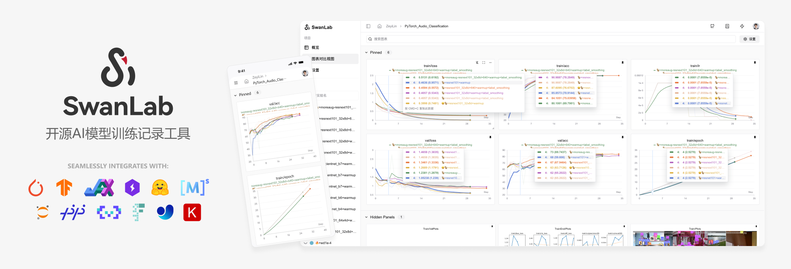
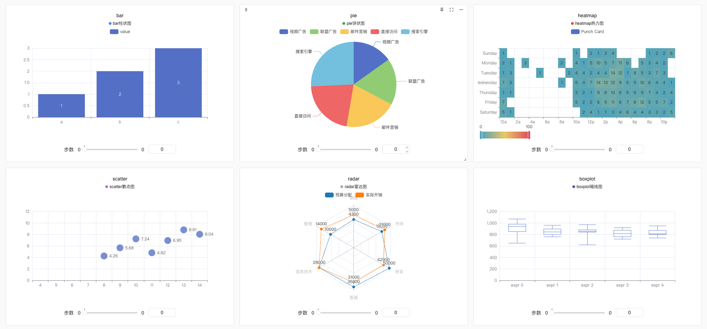
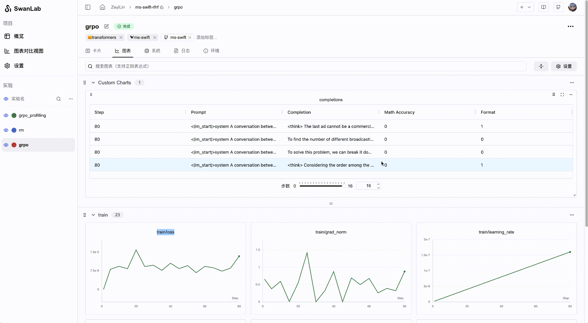
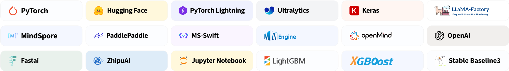
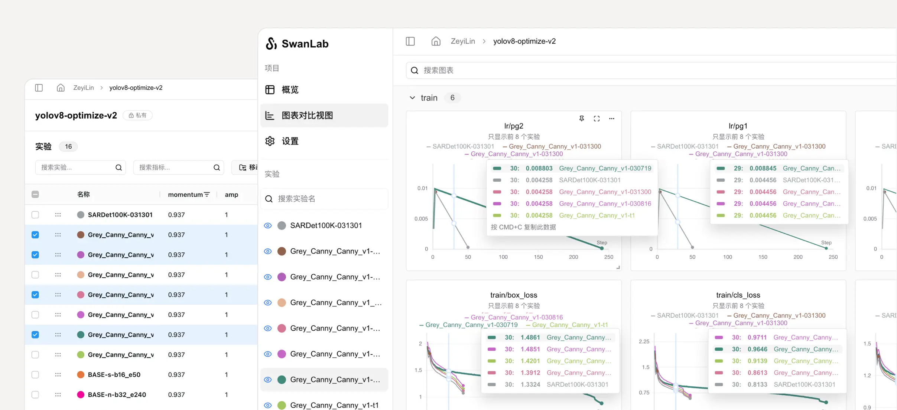
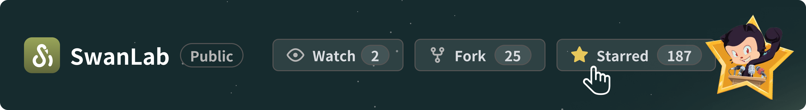
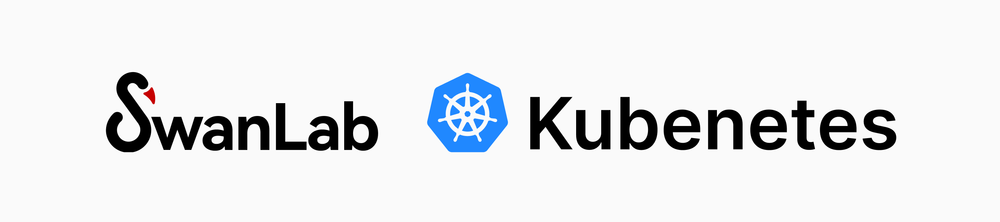
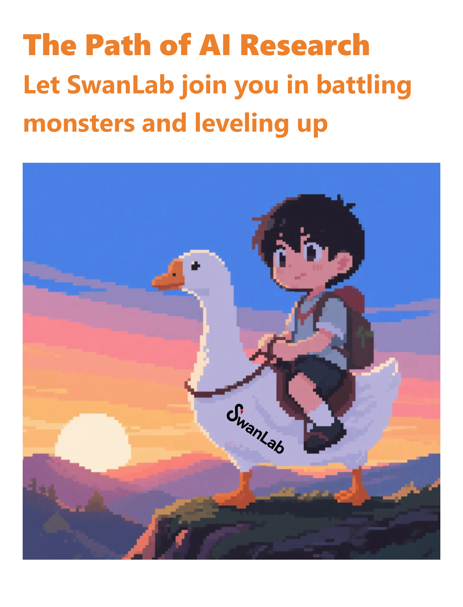

<div align="center">

<picture>
  <source media="(prefers-color-scheme: dark)" srcset="readme_files/swanlab-logo-type2-dark.svg">
  <source media="(prefers-color-scheme: light)" srcset="readme_files/swanlab-logo-type2-light.svg">
  
</picture>

Профессиональная и современная платформа для анализа обучения ИИ-моделей  
Создана для ML-команд: интеграция с 50+ популярными фреймворками и легкое подключение к вашему коду

<a href="https://swanlab.cn">🔥SwanLab Cloud</a> · <a href="https://docs.swanlab.cn/en/">📃 Документация</a> · <a href="https://github.com/swanhubx/swanlab/issues">Сообщить о проблеме</a> · <a href="https://rcnpx636fedp.feishu.cn/share/base/form/shrcnwT9dTedqUchdpgzPzKvcmd">Обратная связь</a> · <a href="https://docs.swanlab.cn/en/guide_cloud/general/changelog.html">История изменений</a> ·  <a href="https://swanlab.cn/benchmarks">Бенчмарки</a> · <a href="https://github.com/SwanHubX/SwanLab-Skill">SKILL</a>

[![][release-shield]][release-link]
[![][dockerhub-shield]][dockerhub-link]
[![][github-stars-shield]][github-stars-link]
[![][github-issues-shield]][github-issues-shield-link]
[![][github-contributors-shield]][github-contributors-link]
[![][license-shield]][license-shield-link]  
[![][tracking-swanlab-shield]][tracking-swanlab-shield-link]
[![][last-commit-shield]][last-commit-shield-link]
[![][pypi-version-shield]][pypi-version-shield-link]
[![][wechat-shield]][wechat-shield-link]
[![][pypi-downloads-shield]][pypi-downloads-shield-link]
[![][colab-shield]][colab-shield-link]



[中文](README.md) / [English](README_EN.md) / [日本語](README_JP.md) / Русский

👋 Присоединяйтесь к нашей [группе в WeChat](https://docs.swanlab.cn/en/guide_cloud/community/online-support.html)

<a href="https://hellogithub.com/repository/b442a9fa270e4ccb8847c9ee3445e41b" target="_blank"></a>

</div>

<br/>

## Содержание

- [👋🏻 Что такое SwanLab](#-что-такое-swanlab)
- [📃 Онлайн-демонстрации](#-онлайн-демонстрации)
- [🏁 Быстрый старт](#-быстрый-старт)
- [💻 Самостоятельное развертывание](#-самостоятельное-развертывание)
- [🔥 Практические примеры](#-практические-примеры)
- [🎮 Мониторинг оборудования](#-мониторинг-оборудования)
- [🚗 Интеграция с фреймворками](#-интеграция-с-фреймворками)
- [🔌 Плагины и API](#-плагины-и-api)
- [🆚 Сравнение с аналогами](#-сравнение-с-аналогами)
- [👥 Сообщество](#-сообщество)
- [📃 Лицензия](#-лицензия)

<br/>

## 👋🏻 Что такое SwanLab

SwanLab — это **платформа для аналитики обучения ИИ и мониторинга метрик (Observability)**, созданная для ML-команд. Она предоставляет инструменты для **визуализации процесса обучения, автоматического логирования, отслеживания гиперпараметров, сравнения экспериментов и командной работы**, помогая быстро выявлять проблемы при обучении и ускорять итерации моделей.

С помощью SwanLab исследователи и ML-инженеры могут находить узкие места обучения на интерактивных графиках, сопоставлять десятки запусков (runs) для поиска оптимальных решений и обмениваться результатами через **веб-интерфейс** и **совместные рабочие пространства организации**.

https://github.com/user-attachments/assets/7965fec4-c8b0-4956-803d-dbf177b44f54

Ключевые возможности:

**1. 📊 Отслеживание метрик и гиперпараметров**: Интеграция в ваш ML-пайплайн с помощью нескольких строк кода для записи ключевых метрик обучения.

- ☁️ **Облачный режим** (аналогично Weights & Biases): отслеживайте прогресс обучения в любое время и с любого устройства. [Просмотр экспериментов со смартфона](https://docs.swanlab.cn/en/guide_cloud/general/app.html).

- 📝 Поддержка **логирования гиперпараметров**, **сводных метрик (summary)** и **табличной аналитики**.

- 🌸 **Визуализация процесса обучения**: интерактивный UI позволяет детально отслеживать динамику каждого шага, анализировать тренды метрик и определять, какие изменения архитектуры или гиперпараметров привели к росту качества модели.

- **Поддерживаемые типы метаданных**: скалярные метрики, изображения, аудио, текст, видео, 3D-облака точек (point clouds), молекулярные структуры, пользовательские графики ECharts...


- **Поддерживаемые типы графиков**: линейные графики, медиа-панели (изображения, аудио, текст, видео), 3D-облака точек, молекулярные структуры, столбчатые диаграммы, диаграммы рассеяния (scatter plots), ящики с усами (box plots), тепловые карты (heatmaps), круговые и лепестковые диаграммы, [пользовательские графики](https://docs.swanlab.cn/en/guide_cloud/experiment_track/log-custom-chart.html)...

[](https://swanlab.cn/@ZeyiLin/swanlab-echarts-demo/charts)

- **Визуализация генераций LLM**: специализированный текстовый компонент для сценариев обучения больших языковых моделей с нативной поддержкой рендеринга Markdown.



- **Автоматическое фоновое логирование**: консольные логи (`stdout`/`stderr`), конфигурация оборудования, состояние Git-репозитория, окружение Python, список установленных пакетов и рабочая директория проекта.

- **Дозапись и возобновление экспериментов (Resume Logging)**: возможность дописывать новые метрики в тот же эксперимент после прерывания или завершения обучения.

**2. ⚡️ Широкая интеграция с фреймворками**: более **30+** фреймворков из коробки, включая PyTorch, 🤗HuggingFace Transformers, PyTorch Lightning, 🦙LLaMA Factory, MMDetection, Ultralytics, PaddleDetection, LightGBM, XGBoost, Keras, TensorBoard, Weights & Biases, MS-Swift, XTuner, Stable-Baselines3 и Hydra.



**3. 💻 Мониторинг оборудования и ускорителей**: сбор и мониторинг системных метрик в реальном времени для CPU, NPU (**Huawei Ascend**), GPU (**NVIDIA**), AMD (**AMD ROCm**), MLU (**Cambricon**), XPU (**Kunlunxin**), DCU (**Hygon**), MetaX GPU (**MetaX**), Moore Threads GPU (**Moore Threads**), Iluvatar GPU (**Iluvatar CoreX**) и оперативной памяти.

**4. 📦 Управление экспериментами**: единый централизованный дашборд, спроектированный специально для задач машинного обучения, позволяет легко управлять множеством проектов и запусков.

**5. 🆚 Сравнение результатов**: сопоставляйте гиперпараметры и итоговые метрики различных экспериментов с помощью интерактивных таблиц и совмещенных графиков.



**6. 👥 Командная работа**: синхронизируйте эксперименты команды в реальном времени внутри единого проекта, просматривайте логи коллег и обсуждайте результаты онлайн.

**7. ✉️ Удобный обмен результатами**: делитесь постоянными ссылками (URL) на отдельные эксперименты с коллегами или встраивайте интерактивные графики напрямую в онлайн-документы (Notion, Lark и др.).

**8. 💻 Поддержка Self-Hosted (On-Premises)**: работа в изолированных (офлайн) контурах; бесплатная Community-версия для самостоятельного развертывания также позволяет просматривать дашборды и управлять экспериментами ([инструкция](#-самостоятельное-развертывание)).

**9. 🔌 Расширение через плагины**: адаптируйте SwanLab под свои задачи с помощью плагинов, таких как [уведомления в Lark](https://docs.swanlab.cn/en/plugin/notification-lark.html), [уведомления в Slack](https://docs.swanlab.cn/en/plugin/notification-slack.html), [CSV-логгер](https://docs.swanlab.cn/en/plugin/writer-csv.html) и др.

> \[!IMPORTANT]
>
> **Поставьте звезду (Star) репозиторию**, чтобы мгновенно получать уведомления о всех новых релизах на GitHub! ⭐️



<br>

## 📃 Онлайн-демонстрации

Ознакомьтесь с интерактивными демо-проектами в SwanLab:

|                       [Классификация кошек и собак (ResNet50)][demo-cats-dogs]                        |                         [Детекция объектов (YOLOv8-COCO128)][demo-yolo]                         |
| :---------------------------------------------------------------------------------------------------: | :---------------------------------------------------------------------------------------------: |
|                              [![][demo-cats-dogs-image]][demo-cats-dogs]                              |                                [![][demo-yolo-image]][demo-yolo]                                |
| Отслеживание обучения модели ResNet50 для задачи классификации изображений на датасете кошек и собак. | Детекция объектов с помощью YOLOv8 на датасете COCO128 с логированием гиперпараметров и метрик. |

|                         [Инструктивный файнтюнинг Qwen2 (SFT)][demo-qwen2-sft]                         |                      [Прогнозирование цен акций Google (LSTM)][demo-google-stock]                       |
| :----------------------------------------------------------------------------------------------------: | :-----------------------------------------------------------------------------------------------------: |
|                              [![][demo-qwen2-sft-image]][demo-qwen2-sft]                               |                            [![][demo-google-stock-image]][demo-google-stock]                            |
| Отслеживание SFT-дообучения большой языковой модели Qwen2 для следования пользовательским инструкциям. | Обучение модели временных рядов LSTM на исторических котировках Google для прогнозирования будущих цен. |

|                [Классификация аудио (ResNeXt101)][demo-audio-classification]                |         [Дообучение Qwen2-VL на датасете COCO][demo-qwen2-vl]         |
| :-----------------------------------------------------------------------------------------: | :-------------------------------------------------------------------: |
|              [![][demo-audio-classification-image]][demo-audio-classification]              |               [![][demo-qwen2-vl-image]][demo-qwen2-vl]               |
| Пошаговое исследование архитектур от ResNet к ResNeXt в задаче классификации аудиосигналов. | LoRA-файнтюнинг мультимодальной модели Qwen2-VL на датасете COCO2014. |

|          [RL-обучение мультимодальной LLM (EasyR1)][demo-easyr1-rl]          |                  [GRPO-обучение Qwen2.5-0.5B][demo-qwen2-grpo]                   |
| :--------------------------------------------------------------------------: | :------------------------------------------------------------------------------: |
|                 [![][demo-easyr1-rl-image]][demo-easyr1-rl]                  |                  [![][demo-qwen2-grpo-image]][demo-qwen2-grpo]                   |
| Обучение с подкреплением (RL) мультимодальной LLM на базе фреймворка EasyR1. | RL-дообучение модели Qwen2.5-0.5B методом GRPO на математическом датасете GSM8K. |

[Больше примеров](https://docs.swanlab.cn/en/examples/mnist.html)

<br>

## 🏁 Быстрый старт

### 1. Установка

```bash
pip install swanlab
```

<details><summary>Установка из исходного кода</summary>

Если вы хотите протестировать самые свежие функции до официального релиза, установите пакет из исходного кода:

```bash
# Способ 1: Editable-установка
git clone https://github.com/SwanHubX/SwanLab.git
pip install -e .

# Способ 2: Установка напрямую из Git
pip install git+https://github.com/SwanHubX/SwanLab.git
```

</details>

<details><summary>Установка расширения офлайн-дашборда</summary>

[Документация по офлайн-дашборду](https://docs.swanlab.cn/en/guide_cloud/offline-board.html)

```bash
pip install 'swanlab[dashboard]'
```

</details>

### 2. Авторизация и получение API-ключа

1. Зарегистрируйте бесплатный аккаунт на [SwanLab](https://swanlab.cn).

2. Войдите в систему и скопируйте ваш ключ в разделе **Настройки пользователя** > [API Key](https://swanlab.cn/settings).

3. Откройте терминал и выполните:

```bash
swanlab login
```

По запросу вставьте ваш API Key и нажмите Enter для завершения авторизации.

### 3. Интеграция SwanLab в ваш скрипт обучения

```python
import swanlab

# Инициализация нового запуска (run) в SwanLab
swanlab.init(
    project="my-first-ml",
    config={"learning-rate": 0.003},
)

# Логирование метрик в цикле обучения
for i in range(10):
    swanlab.log({"loss": i, "acc": i})
```

Готово! Перейдите в [SwanLab](https://swanlab.cn), чтобы изучить результаты вашего первого эксперимента.

<br>

## 💻 Самостоятельное развертывание

Self-hosted версия (Community Edition) позволяет развернуть дашборд SwanLab на собственных серверах или в закрытом контуре без доступа к интернету.



Подробные руководства по развертыванию:

- [🔗 Документация по развертыванию в Kubernetes](https://docs.swanlab.cn/en/self_host/kubernetes/deploy.html)
- [🔗 Документация по развертыванию в Docker](https://docs.swanlab.cn/en/self_host/docker/deploy.html)
- [🔗 Руководство по миграции с Docker на Kubernetes](https://docs.swanlab.cn/en/self_host/docker/migration-docker-kubernetes.html)

<br>

## 🔥 Практические примеры

**Популярные open-source проекты и учебные курсы, использующие SwanLab:**

- [happy-llm](https://github.com/datawhalechina/happy-llm): Практическое руководство по теории и созданию больших языковых моделей (LLM) с нуля. 
- [self-llm](https://github.com/datawhalechina/self-llm): Практический сборник туториалов по быстрому файнтюнингу (Full / LoRA) и деплою открытых LLM и MLLM в среде Linux. 
- [Minimind](https://github.com/jingyaogong/minimind): 🚀🚀 Обучение компактной GPT-модели (26M параметров) полностью с нуля всего за 2 часа! 
- [unlock-deepseek](https://github.com/datawhalechina/unlock-deepseek): Разбор архитектуры, расширение и воспроизведение семейства моделей DeepSeek. 
- [Qwen3-SmVL](https://github.com/ShaohonChen/Qwen3-SmVL): Мультимодальное объединение и дообучение визуального энкодера SmolVLM2 с языковой моделью Qwen3-0.6B. 
- [OPPO/Agent_Foundation_Models](https://github.com/OPPO-PersonalAI/Agent_Foundation_Models): End-to-end базовые модели ИИ-агентов с использованием мультиагентной дистилляции и агентного RL. 
- [Tree-GRPO](https://github.com/AMAP-ML/Tree-GRPO): [ICLR 2026] Применение поиска по дереву (Tree Search) в обучении с подкреплением для LLM-агентов. 
- [FIPO](https://github.com/qwenpilot/FIPO): Официальная реализация алгоритма FIPO — метода RL без функции ценности (value-free RL) для развития глубоких рассуждений в базовых моделях. 
- [llm-agent-rl-lab](https://github.com/KMnO4-zx/llm-agent-rl-lab): Воспроизведение и исследование алгоритмов RL для LLM-агентов, включая PPO, GRPO, GSPO, DAPO, OPD и др. 

**Научные публикации с использованием SwanLab:**

- [Accelerating AlphaZero Training for Connect6 via Behavioral Cloning Initialization and Prior Action Masking in Resource-Constrained Environments](https://papers.ssrn.com/sol3/papers.cfm?abstract_id=6730709)
- [SeePhys Pro: Diagnosing Modality Transfer and Blind-Training Effects in Multimodal RLVR for Physics Reasoning](https://arxiv.org/abs/2605.09266)
- [MemFactory: Unified Inference & Training Framework for Agent Memory](https://arxiv.org/abs/2603.29493)
- [ILL: A Lightweight Large Language Model for Legal and Courtroom Assistance](https://www.mdpi.com/2079-9292/15/11/2401)
- [Retrieval, Reward, and Training Protocols: What Matters in Training Search Agents?](https://arxiv.org/pdf/2605.27881)
- [MolAct: An Agentic RL Framework for Molecular Editing and Property Optimization](https://arxiv.org/abs/2512.20135)
- [CQLLM: A Framework for Generating CodeQL Security Vulnerability Detection Code Based on Large Language Model](https://www.preprints.org/manuscript/202510.1458)
- [Animation Needs Attention: A Holistic Approach to Slides Animation Comprehension with Visual-Language Models](https://arxiv.org/abs/2507.03916)
- [Efficient Model Fine-Tuning with LoRA for Biomedical Named Entity Recognition](https://ieeexplore.ieee.org/abstract/document/11082049/)
- [SpectrumWorld: Artificial Intelligence Foundation for Spectroscopy](https://arxiv.org/abs/2508.01188)
- [CodeBoost: Boosting Code LLMs by Squeezing Knowledge from Code Snippets with RL](https://arxiv.org/pdf/2508.05242)
- [A Joint Classification Method for Traditional Chinese Medicine Diseases and Syndromes Based on BertChinese-RCNNATTN](https://dl.acm.org/doi/full/10.1145/3759972.3759979)
- [A Gradient-Norm-Aware Optimizer for Symmetry-Preserving and Stable Deep Learning](https://www.mdpi.com/2073-8994/18/2/374)
- [TrafficBM: A Dual-Modality Pre-Training Framework for Network Traffic Classification](https://ieeexplore.ieee.org/document/11304658)
- [Using Human Cumulative Prospect Theory to Understand Large Language Models Decision-Making](https://ieeexplore.ieee.org/document/11300712)
- [BiPACE: Bisimulation-Guided Policy Optimization with Action Counterfactual Estimation for LLM Agents](https://arxiv.org/abs/2606.25556)

**Практические туториалы и статьи:**

- [Распознавание рукописных цифр MNIST](https://docs.swanlab.cn/en/examples/mnist.html)
- [Классификация предметов одежды FashionMNIST](https://docs.swanlab.cn/en/examples/fashionmnist.html)
- [Классификация изображений CIFAR-10](https://docs.swanlab.cn/en/examples/cifar10.html)
- [Классификация кошек и собак с помощью ResNet](https://docs.swanlab.cn/en/examples/cats_dogs_classification.html)
- [Детекция объектов с помощью YOLO](https://docs.swanlab.cn/en/examples/yolo.html)
- [Сегментация медицинских изображений с помощью U-Net](https://docs.swanlab.cn/en/examples/unet-medical-segmentation.html)
- [Классификация аудиосигналов](https://docs.swanlab.cn/en/examples/audio_classification.html)
- [Обучение с подкреплением DQN — задача CartPole](https://docs.swanlab.cn/en/examples/dqn_cartpole.html)
- [Прогнозирование цен акций Google с помощью LSTM](https://docs.swanlab.cn/en/examples/audio_classification.html)
- [Классификация текстов с помощью BERT](https://docs.swanlab.cn/en/examples/bert.html)
- [Дообучение Stable Diffusion (Text-to-Image)](https://docs.swanlab.cn/en/examples/stable_diffusion.html)
- [Предобучение (Pre-training) LLM с нуля](https://docs.swanlab.cn/en/examples/pretrain_llm.html)
- [Инструктивный файнтюнинг GLM-4](https://docs.swanlab.cn/en/examples/glm4-instruct.html)
- [Дообучение модели Qwen под прикладные задачи](https://docs.swanlab.cn/en/examples/qwen_finetune.html)
- [Распознавание именованных сущностей (NER)](https://docs.swanlab.cn/en/examples/ner.html)
- [Файнтюнинг медицинской модели на базе Qwen3](https://docs.swanlab.cn/en/examples/qwen3-medical.html)
- [Практика дообучения мультимодальной модели Qwen2-VL](https://docs.swanlab.cn/en/examples/qwen_vl_coco.html)
- [Обучение с подкреплением больших моделей методом GRPO](https://docs.swanlab.cn/en/examples/qwen_grpo.html)
- [Обучение мультимодальной модели Qwen3-SmVL-0.6B](https://docs.swanlab.cn/en/examples/qwen3_smolvlm_muxi.html)
- [Введение в воплощенный ИИ (Embodied AI) с LeRobot](https://docs.swanlab.cn/en/examples/robot/lerobot-guide.html)
- [LoRA-дообучение GLM-4.5-Air и визуализация в SwanLab](https://github.com/datawhalechina/self-llm/blob/master/models/GLM-4.5-Air/03-GLM-4.5-Air-Lora%20%E5%8F%8A%20Swanlab%20%E5%8F%AF%E8%A7%86%E5%8C%96%E5%BE%AE%E8%B0%83.md)
- [Как устроен RAG? Открытая архитектура ассистента по документации SwanLab](https://docs.swanlab.cn/course/prompt_engineering_course/11-swanlab_rag/1.swanlab-rag.html)

🌟 Хотите добавить свой туториал в этот список? Присылайте Pull Request!

<br>

## 🎮 Мониторинг оборудования

SwanLab автоматически собирает **спецификации оборудования** и **метрики утилизации ресурсов** в процессе обучения моделей:

| Оборудование       | Логирование характеристик | Мониторинг ресурсов | Скрипт сбора                                                                                                                                   |
| ------------------ | ------------------------- | ------------------- | ---------------------------------------------------------------------------------------------------------------------------------------------- |
| NVIDIA GPU         | ✅                        | ✅                  | [nvidia.py](https://github.com/SwanHubX/SwanLab/blob/main/swanlab/sdk/internal/probe_python/hardware_vendor/accelerator/nvidia.py)             |
| AMD GPU            | ✅                        | ✅                  | [amd.py](https://github.com/SwanHubX/SwanLab/blob/main/swanlab/sdk/internal/probe_python/hardware_vendor/accelerator/amd.py)                   |
| Huawei Ascend NPU  | ✅                        | ✅                  | [ascend.py](https://github.com/SwanHubX/SwanLab/blob/main/swanlab/sdk/internal/probe_python/hardware_vendor/accelerator/huawei.py)             |
| Cambricon MLU      | ✅                        | ✅                  | [cambricon.py](https://github.com/SwanHubX/SwanLab/blob/main/swanlab/sdk/internal/probe_python/hardware_vendor/accelerator/cambricon.py)       |
| Kunlunxin XPU      | ✅                        | ✅                  | [kunlunxin.py](https://github.com/SwanHubX/SwanLab/blob/main/swanlab/sdk/internal/probe_python/hardware_vendor/accelerator/kunlunxin.py)       |
| Moore Threads GPU  | ✅                        | ✅                  | [moorethreads.py](https://github.com/SwanHubX/SwanLab/blob/main/swanlab/sdk/internal/probe_python/hardware_vendor/accelerator/moorethreads.py) |
| MetaX GPU          | ✅                        | ✅                  | [metax.py](https://github.com/SwanHubX/SwanLab/blob/main/swanlab/sdk/internal/probe_python/hardware_vendor/accelerator/metax.py)               |
| Iluvatar GPU       | ✅                        | ✅                  | [iluvatar.py](https://github.com/SwanHubX/SwanLab/blob/main/swanlab/sdk/internal/probe_python/hardware_vendor/accelerator/iluvatar.py)         |
| Hygon DCU          | ✅                        | ✅                  | [hygon.py](https://github.com/SwanHubX/SwanLab/blob/main/swanlab/sdk/internal/probe_python/hardware_vendor/accelerator/hygon.py)               |
| CPU                | ✅                        | ✅                  | [cpu.py](https://github.com/SwanHubX/SwanLab/blob/main/swanlab/sdk/internal/probe_python/hardware_vendor/cpu.py)                               |
| Оперативная память | ✅                        | ✅                  | [memory.py](https://github.com/SwanHubX/SwanLab/blob/main/swanlab/sdk/internal/probe_python/hardware_vendor/memory.py)                         |

Если вам нужна поддержка других аппаратных ускорителей, будем рады вашим Issue и PR!

<br>

## 🚗 Интеграция с фреймворками

Используйте любимые инструменты разработки вместе со SwanLab!  
Ниже представлен список поддерживаемых интеграций. Если вы хотите предложить интеграцию с другим фреймворком, создайте [Issue](https://github.com/swanhubx/swanlab/issues).

**Базовые фреймворки**

- [PyTorch](https://docs.swanlab.cn/en/guide_cloud/integration/integration-pytorch.html)
- [MindSpore](https://docs.swanlab.cn/en/guide_cloud/integration/integration-ascend.html)
- [Keras](https://docs.swanlab.cn/en/guide_cloud/integration/integration-keras.html)

**Фреймворки для обучения LLM**

- [HuggingFace Transformers](https://docs.swanlab.cn/en/guide_cloud/integration/integration-huggingface-transformers.html)
- [LLaMA Factory](https://docs.swanlab.cn/en/guide_cloud/integration/integration-llama-factory.html)
- [MS-Swift](https://docs.swanlab.cn/en/guide_cloud/integration/integration-swift.html)
- [Unsloth](https://docs.swanlab.cn/en/guide_cloud/integration/integration-unsloth.html)
- [MLX-LM](https://docs.swanlab.cn/en/guide_cloud/integration/integration-mlx-lm.html)
- [torchtune](https://docs.swanlab.cn/en/guide_cloud/integration/integration-pytorch-torchtune.html)
- [PaddleNLP](https://docs.swanlab.cn/en/guide_cloud/integration/integration-paddlenlp.html)
- [Sentence Transformers](https://docs.swanlab.cn/en/guide_cloud/integration/integration-sentence-transformers.html)
- [XTuner](https://docs.swanlab.cn/en/guide_cloud/integration/integration-xtuner.html)
- [OpenMind](https://modelers.cn/docs/en/openmind-library/1.0.0/basic_tutorial/finetune/finetune_pt.html#install-swanlab)

**Фреймворки обучения с подкреплением (RL) для LLM**

- [veRL](https://docs.swanlab.cn/en/guide_cloud/integration/integration-verl.html)
- [HuggingFace TRL](https://docs.swanlab.cn/en/guide_cloud/integration/integration-huggingface-trl.html)
- [NVIDIA NeMo RL](https://docs.swanlab.cn/en/guide_cloud/integration/integration-nvidia-nemo-rl.html)
- [EasyR1](https://docs.swanlab.cn/en/guide_cloud/integration/integration-easyr1.html)
- [AReaL](https://docs.swanlab.cn/en/guide_cloud/integration/integration-areal.html)
- [ROLL](https://docs.swanlab.cn/en/guide_cloud/integration/integration-roll.html)

**Робототехника и Embodied AI**

- [RLinf](https://docs.swanlab.cn/en/guide_cloud/integration/integration-rlinf.html)

**Генерация изображений и видео (Text-to-Image / Video)**

- [DiffSynth Studio](https://docs.swanlab.cn/en/guide_cloud/integration/integration-diffsynth-studio.html)

**Фреймворки глубокого обучения**

- [PyTorch Lightning](https://docs.swanlab.cn/en/guide_cloud/integration/integration-pytorch-lightning.html)
- [MMEngine](https://docs.swanlab.cn/en/guide_cloud/integration/integration-mmengine.html)
- [fastai](https://docs.swanlab.cn/en/guide_cloud/integration/integration-fastai.html)

**Компьютерное зрение (Computer Vision)**

- [Ultralytics](https://docs.swanlab.cn/en/guide_cloud/integration/integration-ultralytics.html)
- [MMDetection](https://docs.swanlab.cn/en/guide_cloud/integration/integration-mmdetection.html)
- [MMSegmentation](https://docs.swanlab.cn/en/guide_cloud/integration/integration-mmsegmentation.html)
- [PaddleDetection](https://docs.swanlab.cn/en/guide_cloud/integration/integration-paddledetection.html)
- [PaddleYOLO](https://docs.swanlab.cn/en/guide_cloud/integration/integration-paddleyolo.html)

**Классическое машинное обучение и градиентный бустинг**

- [LightGBM](https://docs.swanlab.cn/en/guide_cloud/integration/integration-lightgbm.html)
- [XGBoost](https://docs.swanlab.cn/en/guide_cloud/integration/integration-xgboost.html)
- [CatBoost](https://docs.swanlab.cn/en/guide_cloud/integration/integration-catboost.html)

**Фреймворки для оценки моделей (Evaluation)**

- [EvalScope](https://docs.swanlab.cn/en/guide_cloud/integration/integration-evalscope.html)

**Классическое обучение с подкреплением (RL)**

- [Stable-Baselines3](https://docs.swanlab.cn/en/guide_cloud/integration/integration-sb3.html)

**Другие инструменты и фреймворки:**

- [TensorBoard](https://docs.swanlab.cn/en/guide_cloud/integration/integration-tensorboard.html)
- [Weights & Biases](https://docs.swanlab.cn/en/guide_cloud/integration/integration-wandb.html)
- [MLflow](https://docs.swanlab.cn/en/guide_cloud/integration/integration-mlflow.html)
- [HuggingFace Accelerate](https://docs.swanlab.cn/en/guide_cloud/integration/integration-huggingface-accelerate.html)
- [Ray](https://docs.swanlab.cn/en/guide_cloud/integration/integration-ray.html)
- [Hydra](https://docs.swanlab.cn/en/guide_cloud/integration/integration-hydra.html)
- [OmegaConf](https://docs.swanlab.cn/en/guide_cloud/integration/integration-omegaconf.html)
- [SpecForge](https://docs.swanlab.cn/en/guide_cloud/integration/integration-specforge.html)

[Все интеграции](https://docs.swanlab.cn/en/guide_cloud/integration/integration-any-library.html)

<br>

## 🔌 Плагины и API

Расширяйте функциональность SwanLab и автоматизируйте рабочие процессы с помощью плагинов:

- [Создание собственного плагина](https://docs.swanlab.cn/en/plugin/custom-plugin.html)
- [Уведомления по Email](https://docs.swanlab.cn/en/plugin/notification-email.html)
- [Уведомления в Lark](https://docs.swanlab.cn/en/plugin/notification-lark.html)
- [Уведомления в DingTalk](https://docs.swanlab.cn/en/plugin/notification-dingtalk.html)
- [Уведомления в WeCom (WXWork)](https://docs.swanlab.cn/en/plugin/notification-wxwork.html)
- [Уведомления в Discord](https://docs.swanlab.cn/en/plugin/notification-discord.html)
- [Уведомления в Slack](https://docs.swanlab.cn/en/plugin/notification-slack.html)
- [Уведомления в Bark](https://docs.swanlab.cn/en/plugin/notification-bark.html)
- [CSV-логгер](https://docs.swanlab.cn/en/plugin/writer-csv.html)

Программный интерфейс (API):

- [Документация OpenAPI](https://docs.swanlab.cn/en/api/py-openapi.html)

<br>

## 🆚 Сравнение с аналогами

### TensorBoard vs SwanLab

- **☁️ Облачная синхронизация и удаленный доступ**:
  SwanLab позволяет автоматически синхронизировать и хранить эксперименты в облаке, обеспечивая удобный удаленный мониторинг обучения, управление историей проектов, отправку уведомлений и доступ с любых устройств. TensorBoard — это локальный офлайн-инструмент.

- **👥 Командная работа**:
  При совместной разработке ML-моделей SwanLab упрощает ведение общих проектов, обмен ссылками на эксперименты и командное обсуждение результатов. TensorBoard изначально спроектирован для индивидуального использования и не имеет встроенных механизмов коллаборации.

- **💻 Единый централизованный дашборд**:
  Где бы вы ни обучали модели — на локальной рабочей станции, в вычислительном кластере лаборатории или на облачных GPU-инстансах — все запуски агрегируются в единой панели управления. При работе с TensorBoard приходится вручную копировать и собирать файлы `tfevents` с разных серверов.

- **💪 Масштабируемые интерактивные таблицы**:
  Табличное представление SwanLab позволяет просматривать, искать, сортировать и фильтровать результаты тысяч версий моделей, быстро находя лучшие чекпоинты под конкретную задачу. TensorBoard плохо масштабируется на крупные проекты с большим числом запусков.

### Weights & Biases vs SwanLab

- **Weights & Biases** — это закрытая проприетарная MLOps-платформа, требующая подключения к облаку или платной корпоративной лицензии.

- **SwanLab** поддерживает не только облачный режим, но и предоставляет **открытую, бесплатную версию для самостоятельного развертывания (Self-Hosted)** в локальной инфраструктуре.

<br>

## 👥 Сообщество

### Связанные репозитории

- [self-hosted](https://github.com/swanhubx/self-hosted): Скрипты и конфигурации для локального (on-premises) развертывания SwanLab.
- [SwanLab-Docs](https://github.com/swanhubx/swanlab-docs): Репозиторий официальной документации.
- [SwanLab-Dashboard](https://github.com/swanhubx/swanlab-dashboard): Исходный код легковесного офлайн-дашборда, запускаемого командой `swanlab watch`.

### Сообщество и поддержка

- [GitHub Issues](https://github.com/SwanHubX/SwanLab/issues): Сообщения об ошибках и предложения по развитию проекта.
- [Поддержка по Email](mailto:contact@swanlab.cn): Обратная связь и вопросы по использованию SwanLab.
- <a href="https://docs.swanlab.cn/en/guide_cloud/community/online-support.html">Сообщество в WeChat</a>: Обсуждение работы со SwanLab и обмен опытом в области ИИ.

### Бейджи SwanLab для README

Если вы используете SwanLab в своих проектах, добавьте бейдж SwanLab в ваш README:

[![][tracking-swanlab-shield]][tracking-swanlab-shield-link] [![][visualize-swanlab-shield]][visualize-swanlab-shield-link]

```markdown
[](your experiment url)
[](your experiment url)
```

Больше графических материалов и логотипов: [assets](https://github.com/SwanHubX/assets)

### Цитирование SwanLab в научных работах

Если SwanLab оказался полезен в ваших исследованиях, пожалуйста, процитируйте наш проект:

```bibtex
@software{Zeyilin_SwanLab_2023,
  author = {Zeyi Lin, Shaohong Chen, Kang Li, Qiushan Jiang, Zirui Cai,  Kaifang Ji and {The SwanLab team}},
  doi = {10.5281/zenodo.11100550},
  license = {Apache-2.0},
  title = {{SwanLab}},
  url = {https://github.com/swanhubx/swanlab},
  year = {2023}
}
```

### Участие в разработке SwanLab

Хотите внести свой вклад в развитие SwanLab? Ознакомьтесь с [руководством для контрибьюторов](CONTRIBUTING.md).

Мы также будем искренне благодарны за упоминания SwanLab в соцсетях, на профильных мероприятиях и конференциях!

<br>

**Участники проекта (Contributors)**

<a href="https://github.com/swanhubx/swanlab/graphs/contributors">
  
</a>

<br>



## 📃 Лицензия

Этот репозиторий распространяется под открытой лицензией [Apache 2.0 License](https://github.com/SwanHubX/SwanLab/blob/main/LICENSE).

## История звезд (Star History)

<a href="https://www.star-history.com/?repos=swanhubx%2Fswanlab&type=date&legend=top-left">
 <picture>
   <source media="(prefers-color-scheme: dark)" srcset="https://api.star-history.com/chart?repos=swanhubx/swanlab&type=date&theme=dark&legend=top-left&sealed_token=77bt2XJC-p2PM1tRv6wxVLEw_RaNVx2MVWL-FFg2yjKRstx-vq6M_Y0yszVSAAYT4CvkjYMlgSOPU-mvyq_FfRWs7hh2-VFJiwQMtvyr1-7i0F6VgeQwQw" />
   <source media="(prefers-color-scheme: light)" srcset="https://api.star-history.com/chart?repos=swanhubx/swanlab&type=date&legend=top-left&sealed_token=77bt2XJC-p2PM1tRv6wxVLEw_RaNVx2MVWL-FFg2yjKRstx-vq6M_Y0yszVSAAYT4CvkjYMlgSOPU-mvyq_FfRWs7hh2-VFJiwQMtvyr1-7i0F6VgeQwQw" />
   
 </picture>
</a>

<!-- ссылки -->

[release-shield]: https://img.shields.io/github/v/release/swanhubx/swanlab?color=369eff&labelColor=black&logo=github&style=flat-square
[release-link]: https://github.com/swanhubx/swanlab/releases
[license-shield]: https://img.shields.io/badge/license-apache%202.0-white?labelColor=black&style=flat-square
[license-shield-link]: https://github.com/SwanHubX/SwanLab/blob/main/LICENSE
[last-commit-shield]: https://img.shields.io/github/last-commit/swanhubx/swanlab?color=c4f042&labelColor=black&style=flat-square
[last-commit-shield-link]: https://github.com/swanhubx/swanlab/commits/main
[pypi-version-shield]: https://img.shields.io/pypi/v/swanlab?color=orange&labelColor=black&style=flat-square
[pypi-version-shield-link]: https://pypi.org/project/swanlab/
[pypi-downloads-shield]: https://static.pepy.tech/badge/swanlab?labelColor=black&style=flat-square
[pypi-downloads-shield-link]: https://pepy.tech/project/swanlab
[swanlab-cloud-shield]: https://img.shields.io/badge/Product-SwanLab云端版-636a3f?labelColor=black&style=flat-square
[swanlab-cloud-shield-link]: https://swanlab.cn/
[wechat-shield]: https://img.shields.io/badge/WeChat-微信-4cb55e?labelColor=black&style=flat-square
[wechat-shield-link]: https://docs.swanlab.cn/en/guide_cloud/community/online-support.html
[colab-shield]: https://colab.research.google.com/assets/colab-badge.svg
[colab-shield-link]: https://colab.research.google.com/drive/1RWsrY_1bS8ECzaHvYtLb_1eBkkdzekR3?usp=sharing
[github-stars-shield]: https://img.shields.io/github/stars/swanhubx/swanlab?labelColor&style=flat-square&color=ffcb47
[github-stars-link]: https://github.com/swanhubx/swanlab
[github-issues-shield]: https://img.shields.io/github/issues/swanhubx/swanlab?labelColor=black&style=flat-square&color=ff80eb
[github-issues-shield-link]: https://github.com/swanhubx/swanlab/issues
[github-contributors-shield]: https://img.shields.io/github/contributors/swanhubx/swanlab?color=c4f042&labelColor=black&style=flat-square
[github-contributors-link]: https://github.com/swanhubx/swanlab/graphs/contributors
[demo-cats-dogs]: https://swanlab.cn/@ZeyiLin/Cats_Dogs_Classification/runs/jzo93k112f15pmx14vtxf/chart
[demo-cats-dogs-image]: readme_files/example-catsdogs.png
[demo-yolo]: https://swanlab.cn/@ZeyiLin/ultratest/runs/yux7vclmsmmsar9ear7u5/chart
[demo-yolo-image]: readme_files/example-yolo.png
[demo-qwen2-sft]: https://swanlab.cn/@ZeyiLin/Qwen2-fintune/runs/cfg5f8dzkp6vouxzaxlx6/chart
[demo-qwen2-sft-image]: readme_files/example-qwen2.png
[demo-google-stock]: https://swanlab.cn/@ZeyiLin/Google-Stock-Prediction/charts
[demo-google-stock-image]: readme_files/example-lstm.png
[demo-audio-classification]: https://swanlab.cn/@ZeyiLin/PyTorch_Audio_Classification/charts
[demo-audio-classification-image]: readme_files/example-audio-classification.png
[demo-qwen2-vl]: https://swanlab.cn/@ZeyiLin/Qwen2-VL-finetune/runs/pkgest5xhdn3ukpdy6kv5/chart
[demo-qwen2-vl-image]: readme_files/example-qwen2-vl.jpg
[demo-easyr1-rl]: https://swanlab.cn/@Kedreamix/easy_r1/runs/wzezd8q36bb6dlza6wtpc/chart
[demo-easyr1-rl-image]: readme_files/example-easyr1-rl.png
[demo-qwen2-grpo]: https://swanlab.cn/@kmno4/Qwen-R1/runs/t0zr3ak5r7188mjbjgdsc/chart
[demo-qwen2-grpo-image]: readme_files/example-qwen2-grpo.png
[tracking-swanlab-shield-link]: https://swanlab.cn
[tracking-swanlab-shield]: https://raw.githubusercontent.com/SwanHubX/assets/main/badge2.svg
[visualize-swanlab-shield-link]: https://swanlab.cn
[visualize-swanlab-shield]: https://raw.githubusercontent.com/SwanHubX/assets/main/badge1.svg
[dockerhub-shield]: https://img.shields.io/docker/v/swanlab/swanlab-next?color=369eff&label=docker&labelColor=black&logoColor=white&style=flat-square
[dockerhub-link]: https://hub.docker.com/r/swanlab/swanlab-next/tags
